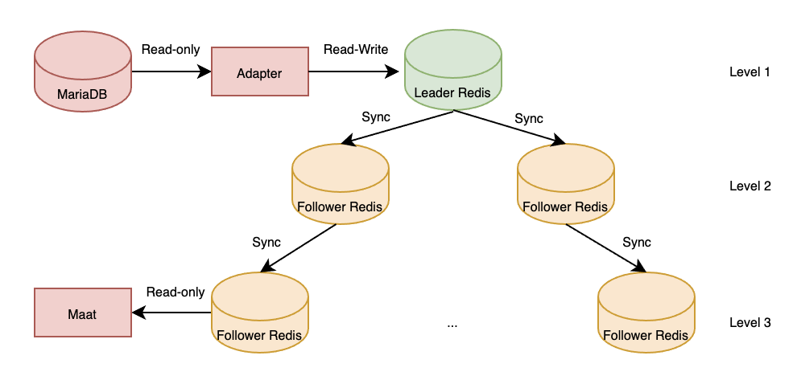
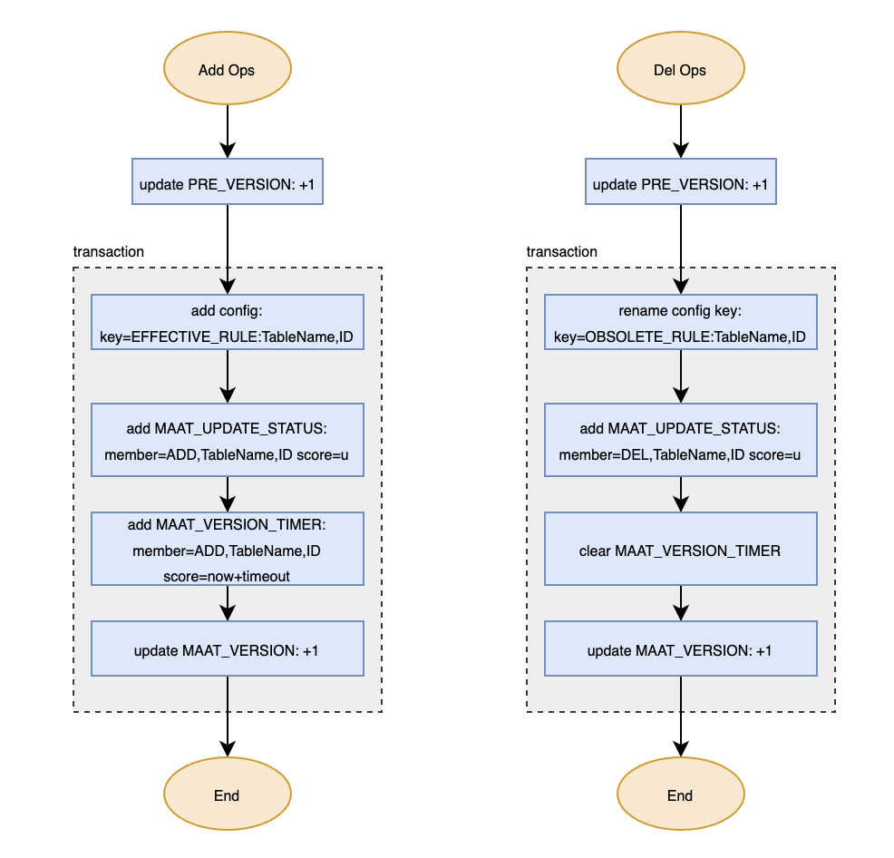
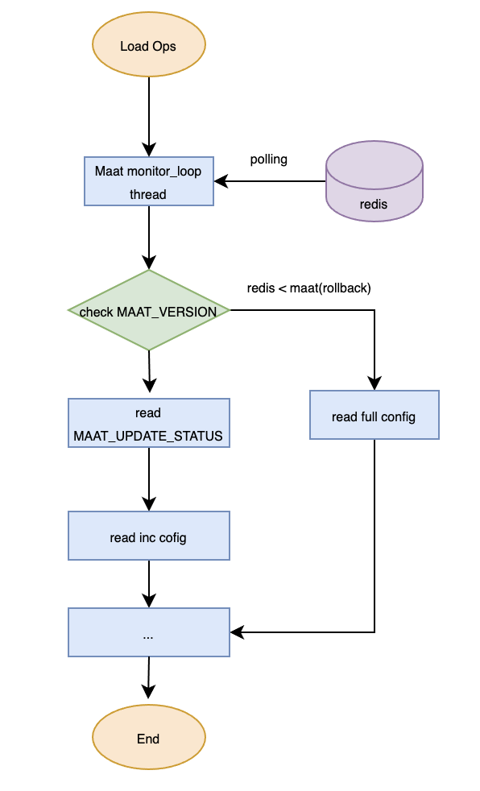

# Configuration management

Input must use UTF-8 without BOM encoding, for example, MySQL use utf8mb4. It supports dynamic loading and multi-machine synchronization of configurations.

Maat supports three configuration loading modes:
- [Redis mode](#1-redis-mode)
- [Json mode](#2-json-mode)
- [Iris mode](#3-iris-mode)

## 1.<a name='Redis mode'></a> Redis mode

As shown in the diagram below, the data source is stored in the relational database `MariaDB`. An adapter writes this data into the `leader redis`, which is then distributed through redis's `leader-follower synchronization` mechanism. The storage structure design in redis for configurations does not need to consider the logical relationships between rule, object, and item. Maat will construct these logical relationships internally after loading the configurations from redis.



### 1.1 Transactional Write

| Redis KEY          | Name             | Structure   | Purpose          |
| ------------------ | ---------------- | ----------- | ---------------- |
| MAAT_VERSION       | primary version  | INTEGER     | Identifies the version number of configurations in redis. When the version number in redis is greater than the version number configured in MAAT, it reads MAAT_UPDATE_STATUS. |
| MAAT_PRE_VERSION   | pre-version      | INTEGER     |        |
| MAAT_TRANSACTION_xx| Transaction configuration status | LIST | Temporarily stores the configuration status in the transaction. xx is one of the states in MAAT_PRE_VERSION, which will be updated to MAAT_UPDATE_STATUS after the transaction ends and will be deleted itself. |
| MAAT_UPDATE_STATUS | Configuration status | sorted set, where the member is a configuration rule and the score is the version number | MAAT reads this using ZRANGEBYSCORE command. |
| MAAT_RULE_TIMER    | Main configuration timeout information | Sorted Set, where the member is a configuration rule and the score is the timeout | MAAT configuration update thread periodically checks timeout status and sets timeout state. |
| MAAT_VERSION_TIMER | Version creation time | Sorted Set  | Stores the creation time of each version, where the score is the version creation time and the member is the version, used to keep MAAT_UPDATE_STATUS within a smaller scale. |
| MAAT_LABEL_INDEX   | Label index | Sorted Set, where the element is the configuration table name, rule_id, and the score is the label_id |      |
| EFFECTIVE_RULE:TableName,ID  OBSOLETE_RULE:TableName,ID | Main configuration | string     | Active configurations, loaded one by one by MAAT.  |
| SEQUENCE_REGION    | Region ID generation sequence   | INTEGER  | Used by producers to generate unique region_id(item_id)  |
| SEQUENCE_OBJECT     | Object ID generation sequence | INTEGER  | Used by producers to generate unique object_id  |
| EXPIRE_OP_LOCK     | Distributed lock  | string "locked"   | Ensures that at most one writer performs eviction.  |

`Note`: The following api supports writing one line of configuration to redis.
```c
int maat_cmd_set_line(struct maat *maat_instance, const struct maat_cmd_line *line_rule);
```

### 1.2 Primary_version、Pre_version and Lua Script

When a producer wants to modify the configuration, it first increments the `preliminary version` and use it as the version for writing the configuration status. Once the configuration change is completed, it then increments the `primary version`. This method can greatly improve the writing performance and ensure successful writing except for ID conflicts.

When there are multiple producers, there may be a nconsistency between the configuration status version and the primary version. Let the primary version be v and the version declared in the configuration status during a particular update be u. Incremental updates by consumers can lead to the following scenarios:

- If v == u, the version numbers are consistent, and the configuration is loaded normally.

- The situation where v > u only occurs when there are three or more producers. This may lead to configuration loss, as illustrated in the table below.

- If v < u, it indicates that among the two producers, the one that started writing first has not yet completed. In this case, only update to version v for this time, and update to u will be carried out in the next polling.

|time |           producer1            |producer2|producer3|consumer|
|-----|--------------------------------|---------|---------|-------|
|0    |ready to update mv=3924, tv=3925|         |         |       |
|1    |         |ready to update mv=3924, tv=3925|         |       |
|2    |         |         |ready to update mv=3924, tv=3927|       |
|3    |         |         |ready to update mv=3925, tv=3927|get version 3925, zrangebyscore can't get status of version 3925|
|4    |         |ready to update mv=3926, tv=3926|         |maat version increased to 3926 with error noncontigous|
|5    |update completed                 |        |         |3925 is skipped|


When consumers perform a full update, they do not need to read the version of the configuration status; instead, they directly read all valid configurations. This is because the configuration write and the increment of the primary version number by 1 are executed within the same transaction. Therefore, the full configuration version read will always be consistent with the primary version.

At the end of the transaction, a Lua script is used to check the transaction version (transaction_version) against the primary version number (maat_version):

- If tv equals mv, no correction is needed.

- If tv is greater than mv, the incremental update for this transaction will be applied in the next iteration.

- If tv is less than mv, how to identify the rules for the configuration status written in this transaction and then can change the score to mv?

To address the issue of transaction version being less than maat_version at the end of the transaction, the Redis list MAAT_TRANSACTION_xx is used to store configuration update status, where xx is derived from MAAT_PRE_VERSION. At the end of the transaction, a Lua script is used to synchronize MAAT_UPDATE_STATUS and delete MAAT_TRANSACTION_xx.



### 1.3 MAAT_UPDATE_STATUS
In this structure, a Sorted Set is used to store the change status of the main configuration, where the score represents the version number and the member represents the configuration status. The first two bytes of the member describe the update instruction:

1. ADD, which signifies configuration addition, has the structure ADD,TableName,ID.

2. DEL, which signifies configuration deletion, has the structure DEL,TableName,ID.

When MAAT detects a change in MAAT_VERSION, it uses ZRANGEBYSCORE to read the updated configuration status (in ascending order of VERSION) and checks the Score of the first configuration. If this Score is greater than Maat version + 1, it indicates missing updates (due to a prolonged network interruption), triggering the full update process.

For DEL status, if the corresponding main configuration status cannot be found, it also indicates missing updates (network interruption duration exceeding the OBSOLETE_RULE timeout), triggering the full update process.

### 1.4 MAAT_VERSION_TIMER

This structure uses a Sorted Set to store the creation time of each version, where the score is the version creation time and the member is the version number (version), corresponding to the score of MAAT_UPDATE_STATUS, to maintain MAAT_UPDATE_STATUS within a smaller scale.

### 1.5 Configuration Structure

There are two types of configuration naming conventions:

1. EFFECTIVE_RULE:TableName,ID indicates the currently effective configuration.

2. OBSOLETE_RULE:TableName,ID indicates configurations that have been deleted. These configurations will be removed from Redis after they expire.

### 1.6 Load From Redis

The working threads of Maat instances periodically poll MAAT_VERSION in redis. If the version in Redis is greater than the instance's MAAT_VERSION, an update is initiated.



### 1.8 Read/Write Performance

To ensure transactions, Redis needs to operate in a single-node + leader-follower mode. Writing configurations with timeouts can achieve a rate of 5000 entries per second, while writing configurations without timeouts can achieve a rate of 10000 entries per second.

## 2. Json Mode

Maat supports loading encrypted and compressed json configurations, a feature that the other two modes do not have. The json mode also supports dynamic loading of configurations. After a Maat instance is created, the monitor_loop thread will periodically check if the json configuration file has changed. If a change is detected, it triggers a full update.

## 3. Iris Mode

In the iris mode, the configuration can only be loaded once when the maat instance is created and cannot be dynamically updated after that. Below is an introduction to the file format in this mode.

A configuration consists of an index file and several configuration data files. The index file is named to identify different versions.

### 3.1 Index File Naming

The full index file is named in the format full_config_index.SEQ (e.g., full_config_index.00000000000000055410), while the incremental index file is named in the format inc_config_index.SEQ. These files are stored in the designated full index directory and incremental index directory, respectively.

Where SEQ is a self-incrementing sequence maintained by the configuration line, ensuring:

1) When two index directories are not empty, newly generated index files have higher sequence numbers than subsequently generated index files (it is recommended to use the configuration version number in the database or write to local disk to ensure consistency).

2) The sequence number for generating full index files and incremental index files in the same deployment is the same.

3) The sequence number is a 20-digit number padded with zeros if it is less than 20 digits. Its value does not exceed the range of signed long long integers in C (i.e., 0 to 2^63-1).

### 3.2 Index File Format

As shown in the table below. Columns are separated by \t and rows are separated by \n. The configuration data file path is an absolute path.

|table_name    |config num |table file path                               |
|--------------|-----------|----------------------------------------------|
|PASS_WHITE_IP |3          |/home/config/full/2024-02-23/PASS_WHITE_IP.123|
|PASS_URL      |2          |/home/config/full/2024-02-23/PASS_URL.123     |

### 3.3 Configuration Data File Format

As shown below, columns are separated by \t and rows are separated by \n. The first line indicates the total number of configurations in the current data file, a value that should match the config_num in the corresponding index file.

```
3
45695	2	202.108.181.33	255.255.255.255	0	1
48697	2	202.108.181.33	255.255.255.255	0	1
66699	2	202.108.181.33	255.255.255.255	0	1
```

### 3.4 Manually Modifying IRIS Configuration

It is generally **not recommended** to directly modify IRIS configurations manually; debugging should be done using the JSON mode.

To add a new table to the configuration, the following files need to be modified:

* Add the new table path and entry count to the table file index.

* Add the table information to the table description file (table_info.json).

* Modify the configuration summary table to apply the new configuration. Ensure that the total number of configurations in the first row matches the actual number of configuration lines.

To manually add an existing table configuration, the following files need to be modified:

* Append a new line to the table file that needs modification. The region_id should not conflict with any existing domain tables, and update the first line of the file with the new number of rows.

* Add the summary information of the new configuration to the configuration summary table. Ensure it matches the rule_id in the table file and does not conflict with any existing rule_id. Update the first line of the file with the new number of rows.

* Modify the row counts for the configuration summary table and domain tables in the table index file.