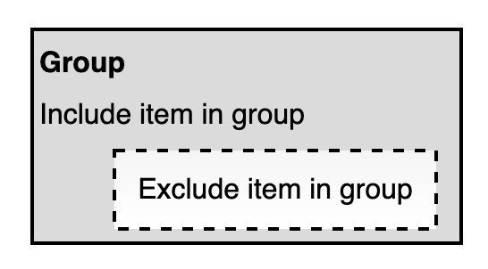
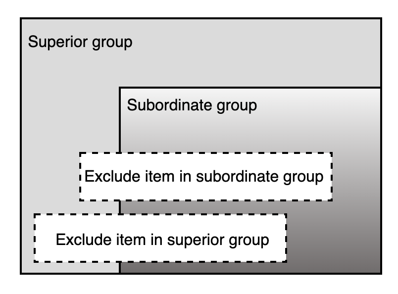
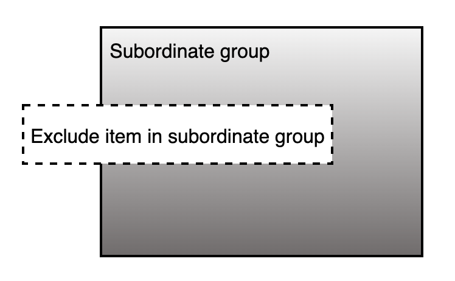
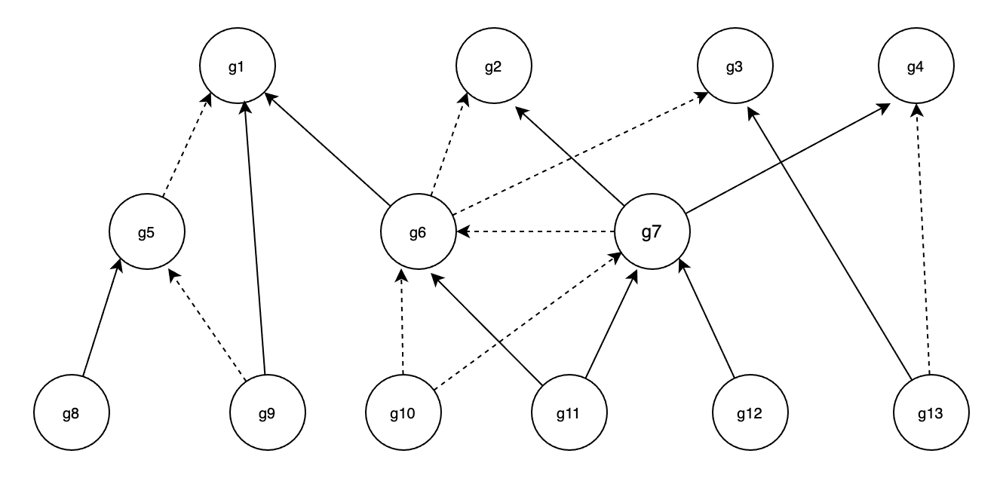
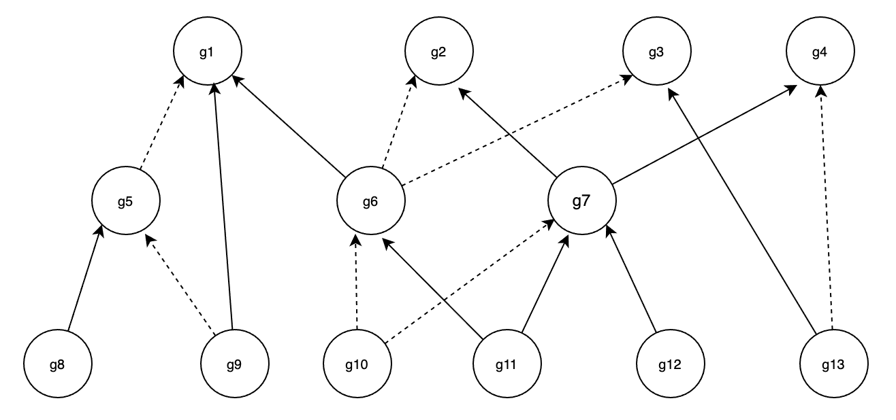
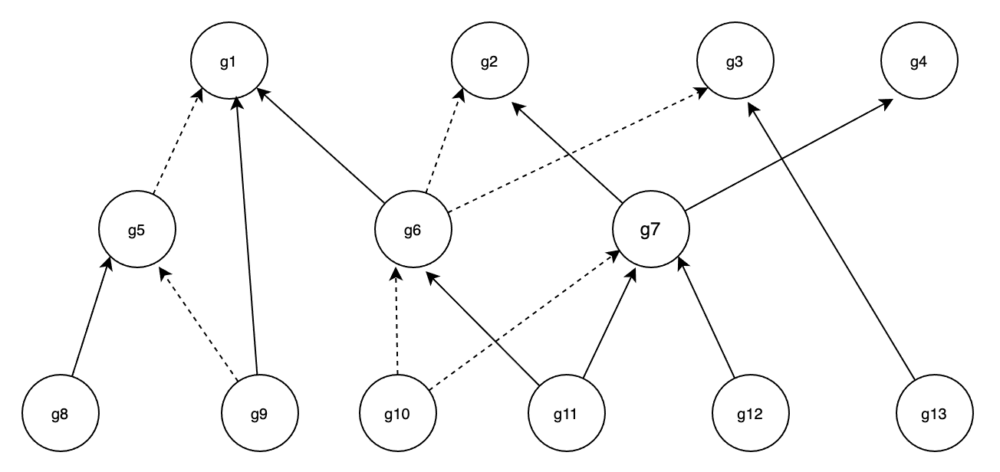

# Group(Object) hierarchies

A group can reference other groups, and can also be referenced by other groups. For example, group_A references group_B, group_A is the superior group of group_B, and group_B is the subordinate group of group_A. There are two reference relationships between groups: `include` and `exclude`. 

## Include

Include is equivalent to the inclusion semantics in set theory. For example, when group_A is included by group_B, if a traffic attribute satisfies group_A, group_B is satisfied. 

## Exclude

A group defines a subset of an group type, such as network addresses or port numbers. The definition is made using items, which can be used to add to or exclude from the group definition. Groups can also have subordinate groups whose definitions are included in the superior group.

There are rules of precedence to take into account when defining groups:

- Excluding has precedence over including in the same group.

- Items in a superior group have precedence over items in a subordinate group.

- Items in a superior group are not taken into account in a subordinate group, if the subordinate group is used directly in a rule.

- Peer groups (different subordinate groups of the same superior group) do not affect each other.

In short, to determine the set defined by a group, perform the following calculation:

1. For each subordinate group (remember sibling groups do not affect each other):
   - Add included items.
   
   - Subtract excluded items.

2. Add included items in the group itself, overriding any excludes in the subordinate groups.

3. Subtract excluded items in the group itself.

The following figure shows a group with an included set and an excluded subset.

Now, consider adding a subordinate group. The subordinate group also has an included set and an excluded subset. If the superior group is used, the result is shown in the following figure “A superior and subordinate group”.

As can be seen, the excluded item in the subordinate group is overwritten since it is in the included set of the superior group. Also, the excluded item from the superior group excludes part of the included item in the subordinate.

If only the subordinate group is used in a rule condition, the superior group items are disregarded, leaving the set shown in the next figure, “The subordinate group”.

Restrictions:

- A group can only include or exclude groups of the same type.

- A group should include at least one subordinate group. (Exclude only is not allowed)

- Traffic attribute using stream scan cannot allow use object(group) with exclude, i.e., keywords object on HTTP Response Body, Email attachment.

Now, let's see a graph of hierarchy example, where the dotted line means exclude. The matched subordinate groups and activated superiors are listed in the following table.

Now, let's see a graph of hierarchy example, where the dotted line means exclude. If the matched subordinate groups: **{g11, g13}**, then activated superiors: **{g2, g7}**.

 

The analysis process is as follows:

**matched groups {g11, g13}**

**Level 1**: g11 => incl{g6, g7} excl{null}, g13 => incl{g3} excl{g4}; new matched groups {g6, g7, g3}, `all matched groups` {g11, g13, g6, g7, g3}

**new matched groups {g6, g7, g3}**

**Level 2**: g6 => incl{g1} excl{g2, g3}, g7 => incl{g2, g4} excl{g6}; new matched groups {g1, g2, g4}, `all matched groups` {g11, g13, g7, g1, g2, g4}

**new matched groups {g1, g2, g4}**

**Level 3**: end

Check the validity of `all matched groups` {g11, g13, g7, g1, g2, g4}:

1. g11, g13 are the originally matched nodes, so keep {g11, g13}.

2. g7 is derived from the match of g11, implying that g10 is not matched (if g10 is matched, then g7 is not matched, as the exclude priority is higher), so keep g7.

3. g1 is derived from the match of g6, but since g6 is excluded due to both g11 and g7, and g6 excludes g7 with higher priority, g1 is no longer matched. Therefore, remove g1 from the set.

3. g1 is derived from the match of g6, which in turn is derived from the match of g11. However, since g7 is also matched and g6 excludes g7 with higher priority, g7's match causes g6 to be unmatched, and consequently, g1 is no longer matched. Therefore, g1 is removed from the set.

4. g2 is derived from the match of g7, with the implied condition that g6 is not matched, so keep g2.

5. Finally, `all matched groups` {g11, g13, g7, g2}, `matched super groups` {g2, g7}.

Remove the dotted line from g7 to g6, as shown in the diagram below. If the matched subordinate groups: **{g11, g13}**, then activated groups: **{g1, g6, g7}**.

 

The analysis process is as follows:

**matched groups {g11, g13}**

**Level 1**: g11 => incl{g6, g7} excl{null}, g13 => incl{g3} excl{g4}; new matched groups {g6, g7, g3}, `all matched groups` {g11, g13, g6, g7, g3}

**new matched groups {g6, g7, g3}**

**Level 2**: g6 => incl{g1} excl{g2, g3}, g7 => incl{g2, g4} excl{null}; new matched groups {g1, g2, g4}, `all matched groups` {g11, g13, g6, g1, g7, g2, g4}

**new matched groups {g1, g2, g4}**

**Level 3**: end

Check the validity of `all matched groups` {g11, g13, g6, g1, g7, g2, g4}:

1. g11, g13 are the originally matched nodes, so keep {g11, g13}.

2. g6 is derived from the match of g11, implying the g10 is not matched(if g10 is matched, then g7 is not matched, as the exclude priority is higher), so keep g6.

3. g1 is derived from the match of g6, which in turn is derived from the match of g11, implying the g5 is not matched, so keep g1.

4. g7 is derived from the match of g11, implying the g10 is not matched, so keep g7.

5. g2 is derived from the match of g7. However, since g6 is also matched and g2 excludes g6 with higher priority, g6's match causes g2 to be unmatched. Therefore, g2 is removed from the set.

6. g4 is derived from the match of g7. However, since g13 is also matched and g4 excludes g13 with higher priority, g13's match causes g4 to be unmatched. Therefore, g4 is removed from the set.

7. Finally, `all matched groups` {g11, g13, g1, g6, g7}, `matched super groups` {g1, g6, g7}.

Again remove the dotted line from g13 to g4, as shown in the diagram below. If the matched subordinate groups: **{g11, g13}**, then activated superiors: **{g1, g4, g6, g7}**.

 

The analysis process is as follows:

**matched groups {g11, g13}**

**Level 1**: g11 => incl{g6, g7} excl{null}, g13 => incl{g3} excl{null}; new matched groups {g6, g7, g3}, `all matched groups` {g11, g13, g6, g7, g3}

**new matched groups {g6, g7, g3}**

**Level 2**: g6 => incl{g1} excl{g2, g3}, g7 => incl{g2, g4} excl{null}; new matched groups {g1, g2, g4}, `all matched groups` {g11, g13, g6, g1, g7, g2, g4}

**new matched groups {g1, g2, g4}**

**Level 3**: end

Check the validity of `all matched groups` {g11, g13, g6, g1, g7, g2, g4}:

1. g11, g13 are the originally matched nodes, so keep {g11, g13}.

2. g6 is derived from the match of g11, implying the g10 is not matched(if g10 is matched, then g7 is not matched, as the exclude priority is higher), so keep g6.

3. g1 is derived from the match of g6, which in turn is derived from the match of g11, implying the g5 is not matched, so keep g1.

4. g7 is derived from the match of g11, implying the g10 is not matched, so keep g7.

5. g2 is derived from the match of g7. However, since g6 is also matched and g2 excludes g6 with higher priority, g6's match causes g2 to be unmatched. Therefore, g2 is removed from the set.

6. g4 is derived from the match of g13, so keep g4.

7. Finally, `all matched groups` {g11, g13, g6, g1, g7, g4}, `matched super groups` {g1, g4, g6, g7}.

The above example is strictly consistent with the case `GroupExcludeTest.level_3_function` in the [test/group_nesting](../test/group_nesting/) test. Please run it to see the actual execution results.