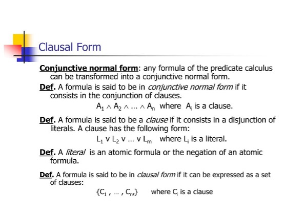
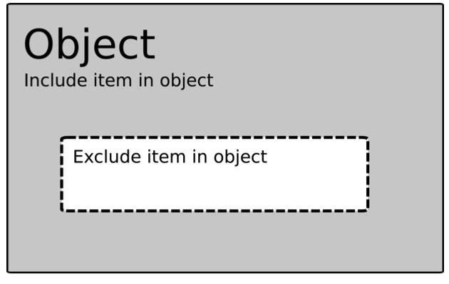
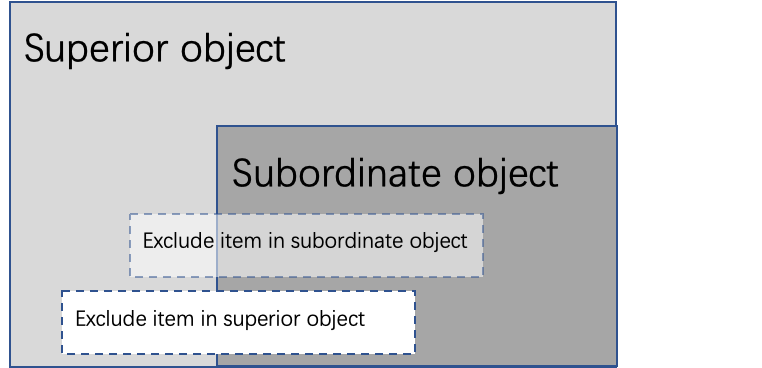
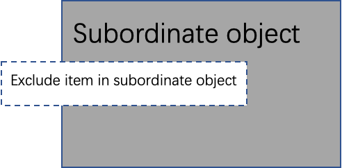

# 概念

Item，对网络属性的过滤条件，某一字段的配置

- 例1，指定HTTP协议中UserAgent包含子串“Chrome”和“11.8.1”
- 例2，指定HTTP协议中域名以“.emodao.com”结尾
- 例3，指定客户端IP地址属于202.118.101.*这个C段
- 例4，指定HTTP协议中传输的文件摘要为” FsOmaK3utZafWYt/i[7203:46299992]”

Item的类型包括字符串过滤条件（如关键词、正则表达式）、IP过滤条件（掩码、CIDR、范围）、数值区间和内容摘要（Stream Fuzzy Hash）。

分组配置，Group，又称Object，是Item的集合

- 一个Item属于一个Group，同一Group中的多个Item是“或”的关系；
- 一个Group可以被其它Group包含（Include）或排除（Exclude）
- Group支持多层嵌套
- 一个Group可以被多个Compile引用

编译配置是由多个Group和虚拟表组成的合取范式

- 合取范式可以包含最多8个子句（Clause），同一个编译中的多个子句之间可以是“与”和“非”运算。
- 一个子句包含若干个Literal，Literal虚拟表（可选）和Group组成，之间是“或”运算。在配置加载过程中会按照同一个子句中的虚拟表+分组ID的组合生成唯一的Clause ID，Clause ID不会被不同的组合重用。
- 例如，对于同时符合上面例1、例2、例3的访问进行重定向操作，重定向策略ID=31(重定向地址为www.baidu.com，黑名单5分钟)，记录日志

## Group/Object Nesting and Hierarchies

The objects and items are compared in the rule evaluation with **OR** operator. If a traffic attribute satisfies an item, the object it belongs to is satisfied.

### Exclude

An object defines a subset of an object type, such as network addresses or port numbers. The definition is made using items, which can be used to add to or exclude from the object definition. Objects can also have subordinate objects whose definitions are included in the superior object.

There are rules of precedence to take into account when defining objects:

- Excluding has precedence over including in the same object.
- Items in a superior object have precedence over items in a subordinate object.
- Items in a superior object are not taken into account in a subordinate object, if the subordinate object is used directly in a rule.
- Peer objects (different subordinate objects of the same superior object) do not affect each other.

In short, to determine the set defined by an object, perform the following calculation:

1. For each subordinate object (remember sibling objects do not affect each other):
   1. Add included items.
   2. Subtract excluded items.
2. Add included items in the object itself, overriding any excludes in the subordinate objects.
3. Subtract excluded items in the object itself.

The following figure shows an object with an included set and an excluded subset.

Now, consider adding a subordinate object. The subordinate object also has an included set and an excluded subset. If the superior object is used, the result is shown in the following figure “A superior and subordinate object”.

As can be seen, the excluded item in the subordinate object is overwritten since it is in the included set of the superior object. Also, the excluded item from the superior object excludes part of the included item in the subordinate.

If only the subordinate object is used in a rule condition, the superior object items are disregarded, leaving the set shown in the next figure, “The subordinate object”.

Restrictions:

- An object can only include or exclude objects of the same type.
- An object should include at least one subordinate object. (Exclude only is not allowed)
- Traffic attribute using stream scan cannot allow use object with exclude, i.e., keywords object on HTTP Response Body, Email attachment.

Now, let's see a graph of hierarchy example, where the dotted line means exclude. The matched subordinate objects and activated superiors are listed in the following table.

| **Matched subordinate objects** | **Activated superior Objects** |
| ------------------------------- | ------------------------------ |
| g1, g3                          | g6, g9                         |
| g3, g4                          | none                           |
| g5                              | g8, g10, g13                   |
| g2, g3                          | g9                             |
| g3, g5                          | none                           |
| g8, g11                         | g10, g12                       |
| g4, g11                         | g7, g8, g9                     |
| g1, g2                          | g9                             |

## 定义

| **名词**                    | **解释**                                                     |
| --------------------------- | ------------------------------------------------------------ |
| Instance                    | MAAT的句柄                                                   |
| Item                        | 针对一个数据中某一域的配置，如HTTP协议中的URL、DNS协议的IP地址等。 |
| Group/Object                | 一条或多条域配置的集合，分组内的域配置之间是或的关系。       |
| Compile (编译配置)          | 描述通过一条或多条分组配置“与”“非”运算，所执行的业务规则。   |
| Table（配置表）             | 在数据库表文件和规则扫描之间的抽象层，既可以是存储域配置、分组配置、编译配置的实体表，也可以是实体表的组合、虚拟和连接。 |
| Table Schema （配置表模式） | 定义配置表中存放的配置类型和字段格式                         |
| Table Runtime               |                                                              |
| Maat State                  | 用于记录扫描多个多流量属性的中间状态                         |
| Maat Stream                 | 用于流式文本扫描的句柄                                       |
| Hit Path（命中路径）        | 从待扫描数据的角度，描述其域ID->子分组ID->顶级分组ID（含虚拟表名）->编译配置的ID序列，称为命中路径。 |
| Redis                       | 内存数据库，参见https://redis.io/  ，通过其主从备份机制实现配置的多级同步。 |