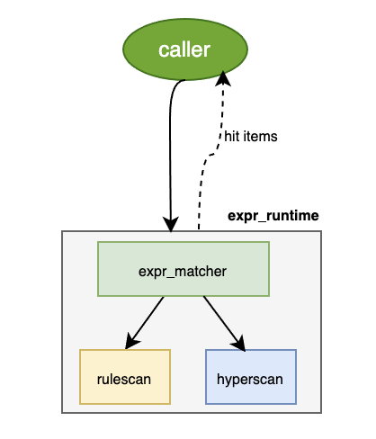

# Maat table

The maat table consists of two parts: `schema` and `runtime`, which is the core skeleton of maat. In a production environment, maat periodically loads the configurations from redis and parses it according to the schema, building a table-based runtime for use by the scanning interface.

* [table schema](#1-table-schema)
* [table runtime](#2-table-runtime)

## 1. Table schema

Maat tables are divided into two categories: physical tables that actually exist in the database and attributes that reference physical tables.

The types of physical tables are as follows:
- [item table](#11-item-table)
- [rule table](#12-rule-table)
- [object2rule table](#13-object2rule-table)
- [object_group table](#14-object_group-table)
- [plugin table](#15-plugin-table)
- [ip_plugin table](#16-ip_plugin-table)
- [fqdn_plugin table](#17-fqdn_plugin-table)
- [bool_plugin table](#18-bool_plugin-table)
- [ipport_plugin table](#19-ipport_plugin-table)

Different physical tables can be combined into one table, see [conjunction table](#110-conjunction-table)

A attribute can only reference one physical table or conjuntion table, see [attribute](#111-attribute)

### 1.1 <a name='Itemtable'></a> Item table

Item tables are further subdivided into different types of subtables as follows:
- [expr item table](#111-expr-item-table)
- [expr_plus item table](#112-expr_plus-item-table)
- [ip item table](#113-ip-item-table)
- [interval item table](#114-interval-item-table)
- [interval_plus item table](#115-interval_plus-item-table)
- [flag item table](#116-flag-item-table)
- [flag_plus item table](#117-flag_plus-item-table)

Each item table must has the following columns:

- item_id: In a maat instance, the item id is globally unique, meaning that the item id of different tables must not be duplicate.

- object_id: Indicate the object to which the item belongs, an item belongs to only one object.

- is_valid: In incremental updates, 1(valid means add) 0(invalid means del)

The range of item_id(object_id, rule_id) is 0～2^63，which is 8 bytes.

#### 1.1.1 <a name='exprtable'></a> expr item table

Describe matching rules for strings.

| **FieldName**    | **type**       | **constraint** |
| ---------------- | -------------- | ------- |
| **item_id**      | LONG LONG      | primary key |
| **object_id**     | LONG LONG      | leaf object id, can be referenced by object_group & object2rule table |
| **keywords**     | VARCHAR2(1024) | field to match during scanning |
| **expr_type**    | INT            | 0(keywords), 1(AND expr), 2(regular expr), 3(substring with offset)
| **match_method** | INT            | only useful when expr_type is 0. 0(sub), 1(suffix), 2(prefix), 3(exactly) |
| **is_hexbin**    | INT            | 0(not HEX & case insensitive, this is default value)  1(HEX & case sensitive)  2(not HEX & case sensitive) |
| **is_valid**     | INT            | 0(invalid), 1(valid) |

The table schema is stored in table_info.json.
```c
{
    "table_id":3,  //[0 ~ 1023], don't allow duplicate
    "table_name":"HTTP_URL", //db table's name
    "table_type":"expr",
    "valid_column":7,    //7th column(is_valid field)
    "custom": {
        "item_id":1,     //1st column(item_id field)
        "object_id":2,    //2nd column(object_id field)
        "keywords":3,    //3rd column(keywords field)
        "expr_type":4,   //4th column(expr_type field)
        "match_method":5,//5th column(match_method field)
        "is_hexbin":6    //6th column(is_hexbin field)
    }
}

/* If you want to combine multiple physical tables into one table, db_tables should be added as follows.
   The value of table_name can be a user-defined string, the value of db_tables is the table name that actually exists in database. */
{
    "table_id":3,  //[0 ~ 1023], don't allow duplicate
    "table_name":"HTTP_REGION", //user-defined string
    "db_tables":["HTTP_URL", "HTTP_HOST"],
    "table_type":"expr",
    "valid_column":7,
    "custom": {
        "item_id":1,
        "object_id":2,
        "keywords":3,
        "expr_type":4,
        "match_method":5,
        "is_hexbin":6
    }
}
```

`expr_type` column represents the expression type:

1. keywords matching(0), match_method column as follows
    - substring matching (0)
        
        For example: substring: "China", scan_data: "Hello China" will hit, "Hello World" will not hit

    - suffix matching (1)
    
        For example: suffix: ".baidu.com", scan_data: "www.baidu.com" will hit, "www.google.com" will not hit

    - prefix matching (2)
        
        For example: prefix: "^abc", scan_data: "abcdef" will hit, "1abcdef" will not hit

    - exactly matching (3)
    
        For example: string: "World", scan_data: "World" will hit, "Hello World" will not hit

2. AND expression(1), supports up to 8 substrings. 

    For example: AND expr: "yesterday&today", scan_data: "Goodbye yesterday, Hello today!" will hit, "Goodbye yesterday, Hello tomorrow!" will not hit.

3. Regular expression(2)

    For example: Regex expr: "[W|world]", scan_data: "Hello world" will hit, "Hello World" will hit too.

4. substring matching with offset(3)
  - offset start with 0, [offset_start, offset_end] closed interval

  - multiple substrings with offset are logical AND

    For example: substring expr: "1-1:48&3-4:4C4C", scan_data: "HELLO" will hit, "HLLO" will not hit.
    **Note**: 48('H') 4C('L')

Since Maat4.0, only UTF-8 is supported, and encoding conversion is no longer supported. For binary format rules, keywords are represented in hexadecimal, such as the keyword "hello" being represented as "68656C6C6F". Keywords cannot contain invisible characters such as spaces, tabs, and carriage returns, which have ASCII codes from 0x00 to 0x1F and 0x7F. If these characters need to be used, they must be escaped, referring to the "keyword escape table". Characters led by backslashes outside this table are processed as ordinary strings, such as '\t' being processed as the string "\t".

The symbol '&' represents the conjunction operation in an AND expression. Therefore, if a keyword contains '&', it must be escaped as '\&'.

**keywords escape table**

| **symbol** | **ASCII code** | **symbol after escape** |
| ---------- | -------------- | ----------------------- |
| \          | 0x5c           | \\\                     |
| &          | 0x26           | \\&                     |
| blank space| 0x20           | \b                      |

Length constraint：

- Single substring no less than 3 bytes

- No less than 3 bytes for a single substring in AND expression

- Support up to 8 substrings in one AND expression, expr = substr1 & substr2 & substr3 & substr4 & substr5 & substr6 & substr7 & substr8

- The length of one AND expression should not exceed 1024 bytes(including '&')

#### 1.1.2 <a name='ExprPlusItemTable'></a> expr_plus item table
Describe extended matching rules for strings by adding the district column.

| **FieldName**    | **type**       | **constraint** |
| ---------------- | -------------- | ------- |
| **item_id**      | LONG LONG      | primary key |
| **object_id**     | LONG LONG      | leaf object id, can be referenced by object_group & object2rule table |
| **district**     | VARCHAR2(1024) | describe the effective position of the keywords |
| **keywords**     | VARCHAR2(1024) | field to match during scanning |
| **expr_type**    | INT            | 0(keywords), 1(AND expr), 2(regular expr), 3(substring with offset)
| **match_method** | INT            | only useful when expr_type is 0 |
| **is_hexbin**    | INT            | 0(not HEX & case insensitive, this is default value)  1(HEX & case sensitive)  2(not HEX & case sensitive) |
| **is_valid**     | INT            | 0(invalid), 1(valid) |


For example, if the district is User-Agent and keywords is Chrome, scanning in the following way will hit.
```c
    const char *scan_data = "Chrome is fast";
    const char *district = "User-Agent";

    maat_state_set_scan_district(..., district, ...);
    maat_scan_string(..., scan_data, ...)
```

#### 1.1.3 <a name='IPItemTable'></a> ip item table

Describe matching rules for IP address. Both the address and port are represented by string, IPv4 is dotted decimal and IPv6 is colon separated hexadecimal.

| **FieldName**  | **type**     | **constraint** |
| -------------- | ------------ | -------------- |
| **item_id**    | LONG LONG    | primary key |
| **object_id**   | LONG LONG    | leaf object id, can be referenced by object_group & object2rule table |
| **addr_type**  | INT          | Ipv4 = 4 Ipv6 = 6 |
| **addr_format**| VARCHAR2(40) | ip addr format, single/range/CIDR/mask |
| **ip1**        | VARCHAR2(40) | start ip |
| **ip2**        | VARCHAR2(40) | end ip |
| **is_valid**   | INT          | 0(invalid), 1(valid) |

#### 1.1.4 <a name='IntervalItemTable'></a> interval item table

Determine whether an integer is within a certain numerical range.

| **FieldName**    | **type** | **constraint** |
| ---------------- | -------- | -------------- |
| **item_id**      | INT      | primary key |
| **object_id**     | INT      | leaf object id, can be referenced by object_group & object2rule table |
| **low_boundary** | INT      | lower bound of the numerical range(including lb), 0 ~ (2^32 - 1)|
| **up_boundary**  | INT      | upper bound of the numerical range(including ub), 0 ~ (2^32 - 1)|
| **is_valid**     | INT      | 0(invalid), 1(valid) |

#### 1.1.5 <a name='IntervalPlusItemTable'></a> interval_plus item table

Describe extended matching rules for integer by adding the district column.

| **FieldName**    | **type** | **constraint** |
| ---------------- | -------- | -------------- |
| **item_id**      | INT      | primary key |
| **object_id**     | INT      | leaf object id, can be referenced by object_group & object2rule table |
| **district**     | VARCHAR2(1024)| describe the effective position of the keywords |
| **low_boundary** | INT      | lower bound of the numerical range(including lb), 0 ~ (2^32 - 1)|
| **up_boundary**  | INT      | upper bound of the numerical range(including ub), 0 ~ (2^32 - 1)|
| **is_valid**     | INT      | 0(invalid), 1(valid) |

#### 1.1.6 <a name="FlagItemTable"></a> flag item table

| **FieldName** | **type** | **constraint** |
| ------------- | -------- | -------------- |
| **item_id**   | INT      | primary key |
| **object_id**  | INT      | leaf object id, can be referenced by object_group & object2rule table |
| **flag**      | INT      | flag, 0 ~ (2^32 - 1)|
| **flag_mask** | INT      | flag_mask, 0 ~ (2^32 - 1)|
| **is_valid**  | INT      | 0(invalid), 1(valid) |

#### 1.1.7 <a name="FlagPlusItemTable"></a> flag_plus item table

| **FieldName** | **type** | **constraint** |
| ------------- | -------- | -------------- |
| **item_id**   | INT      | primary key |
| **object_id**  | INT      | leaf object id, can be referenced by object_group & object2rule table |
| **district**  | INT      | describe the effective position of the flag |
| **flag**      | INT      | flag, 0 ~ (2^32 - 1)|
| **flag_mask** | INT      | flag_mask, 0 ~ (2^32 - 1)|
| **is_valid**  | INT      | 0(invalid), 1(valid) |

### 1.2 <a name='RuleTable'></a> rule table

Describe the specific policy, one maat instance can has multiple rule tables with different names.

| **FieldName**  | **type**       | **constraint**  |
| -------------- | -------------- | --------------- |
| **rule_id** | LONG LONG      | primary key, rule id |
| **tags**       | VARCHAR2(1024) | default 0，means no tag |
| **is_valid**   | INT            | 0(invalid)，1(valid)  |
| **condition_num** | INT            | no more than 8 conditions |

### 1.3 <a name='Object2RuleTable'></a> object2rule table

Describe the relationship between object and rule.

| **FieldName**     | **type**      | **constraint** |
| ----------------- | ------------- | -------------- |
| **object_ids**     | VARCHAR(256)  | object ids are separated by commas(g1,g2,g3) |
| **rule_id**    | LONG LONG     | rule id |
| **is_valid**      | INT           | 0(invalid), 1(valid) |
| **negate_option**      | INT           | logical 'NOT', identify a negate condition, 0(no) 1(yes) |
| **attribute** | VARCHAR2(256) | attribute name, NOT NULL |
| **Nth_condition**    | INT           | the condition seq in (conjunctive normal form)CNF, from 0 to 7. objects with the same condition ID are logical 'OR' |

NOTE: If object_id is invalid in xx_item table, it must be marked as invalid in this table.

### 1.4 <a name='Object2ObjectTable'></a> object_group table 

Describe the relationship between objects.

| **FieldName**          | **type**     | **constraint** |
| ---------------------- | ------------ | ---------------|
| **object_id**           | LONG LONG    | reference from xx_item table's object_id |
| **incl_sub_object_ids** | VARCHAR(256) | included sub object ids are separated by commas(g1,g2,g3)|
| **excl_sub_object_ids** | VARCHAR(256) | excluded sub object ids are separated by commas(g4,g5)|
| **is_valid**           | Bool         | (invalid), 1(valid) |


### 1.5 <a name='PluginTable'></a> plugin table

There is no fixed rule format of the plugin table, which is determined by business side. The plugin table supports two sets of callback functions, registered with **maat_table_callback_register** and **maat_plugin_table_ex_schema_register** respectively.

```c
int maat_table_callback_register(struct maat *instance, int table_id,
								 maat_start_callback_t *start_cb,
								 maat_update_callback_t *update_cb,
								 maat_finish_callback_t *finish_cb,
								 void *u_para);
```

When the plugin table rules are updated, `start_cb` will be called first and only once, then `update_cb` will be called by each rule item, and `finish_cb` will be called last and only once.

If rules have been loaded but maat_table_callback_register has not yet been called, maat will cache the loaded rules and perform the callbacks(start, update, finish) when registration is complete.

This set of callbacks is concerned with changes to the table, including when the table starts to change (start_cb), the type of change (full or incremental), when the change ends (finish_cb), and the specific content of each change (update_cb).

```c
int maat_plugin_table_ex_schema_register(struct maat *instance, const char *table_name,
                                         maat_ex_new_func_t *new_func,
                                         maat_ex_free_func_t *free_func,
                                         maat_ex_dup_func_t *dup_func,
                                         long argl, void *argp);
```

This interface registers a set of callback functions for the xx_plugin table. Unlike the callbacks registered with `maat_table_callback_register`, when adding a configuration, the `new_func` is called immediately, and when deleting a configuration, the `free_func` is not called immediately due to the introduction of a garbage collection mechanism. Instead, the free_func is called when the garbage collection queue starts the collection process.

this set of callbacks is concerned with the specific configuration changes line by line, which configuration is added (new_func), which configuration is deleted (free_func), and which configuration can be queried for ex_data (dup_func).

```c
void *maat_plugin_table_get_ex_data(struct maat *instance, int table_id,
                                    const char *key, size_t key_len);
```

Plugin table supports three types of keys to query ex_data.

1. Pointer key(compatible with maat3)
2. Integer key
3. Ipv4 or ipv6 address as key.

### 1.6 <a name='IpPluginTable'></a> ip_plugin table

Similar to plugin table but the key of maat_ip_plugin_table_get_ex_data is ip address.

### 1.7 <a name='FQDNPlugintable'></a> fqdn_plugin table

Scan the input string according to the domain name hierarchy '.'

Return results order: sort by decreasing the length of the hit rule

For example:
1. example.com.cn
2. com.cn
3. example.com.cn
4. cn
5. ample.com.cn

If the input string is example.com.cn, the expected result order would be: 3, 1, 2, 4. The 'ample' in rule 5 is not part of the domain hierarchy and should not be returned.

### 1.8 <a name='BoolPluginTable'></a> bool_plugin table

Scan the input integer array based on a boolean expression, such as [100, 1000, 2, 3].

The boolean expression rule is numbers separated by "&", for example, "1&2&1000".

### 1.9 <a name='IpPortPluginTable'></a>ipport_plugin table

Different from IPPlugin table, which uses ip as the key, IPPortPlugin table uses ip+port as the key, which can meet users' more refined ex_data query requirements. For example, by building a mapping from ip+port to subscriber ID, network traffic can be distributed based on subscriber ID.

### 1.10 <a name='ConjunctionTable'></a> conjunction table

By default, maat builds a separate runtime for each physical table, which can be used for rule matching by specifying the table ID during scanning. If the user wants to combine multiple physical tables of the same type into a single table for runtime build and scan, it means conjunction of multiple tables. 

For example: HTTP_REGION is the conjunction of HTTP_URL and HTTP_HOST.

```json
{
    "table_id":1,
    "table_name":"HTTP_REGION",
    "db_tables":["HTTP_URL", "HTTP_HOST"],
    "table_type":"expr",
    "valid_column":7,
    "custom": {
        "item_id":1,
        "object_id":2, 
        "keywords":3,
        "expr_type":4,
        "match_method":5,
        "is_hexbin":6
    }
}
```

`Note`: Only physical tables support conjunction.

### 1.11 <a name='Attribute'></a> attribute

A physical table refers to a table that physically exists in the database. In contrast, there are no attributes in the database. Attributes are merely references to physical tables, where one attribute can only reference one physical table. If you want to reference multiple physical tables of the same type, you need to first combine these physical tables into a conjunction table, and then have the attribute reference it. A physical table can be referenced by multiple attributes.

Attributes are often used for different traffic attributes, where different attributes represent different traffic attributes, such as HTTP_HOST, HTTP_URL, and so on.

### 1.12 <a name='ForeignFiles'></a>Foreign Files

In callback configurations, specific fields can point to external content, currently supporting pointing to a key in Redis.

The foreign key column in the callback table must have the prefix "redis://". The content stored in Redis as a foreign key must have the prefix "__FILE_". When the key is "null", it indicates that the file is empty.

For example, if the original file is ./testdata/mesa_logo.jpg, and after calculating its MD5 value, we get the Redis foreign key __FILE_795700c2e31f7de71a01e8350cf18525, the format written in the callback table would be as follows:

```
14	./testdata/digest_test.data	redis://__FILE_795700c2e31f7de71a01e8350cf18525 1
```

Each row in the callback table can have a maximum of 8 foreign keys, and the foreign key content can be set using the Maat_cmd_set_file function.

Before notifying the callback table, Maat fetches the foreign keys to local files and replaces the foreign key column with the local file path.

### 1.13 <a name='Tags'></a>Tags

By matching the tags accepted by Maat with the configuration tags, selective configuration loading is achieved. Configuration tags are a collection of tag arrays, denoted as "tag_sets", while Maat accepts tags are tag arrays denoted as "tags".

Configuration tags are tags stored on compilation configurations or object configurations, identifying where the configuration is effective in which Maat instances. It consists of multiple tag sets, where multiple tags within a set are ANDed, and multiple values of a tag are ORed.

## 2. Table runtime

Maat loads the configuration of different types of tables into memory to form the corresponding runtime for each table. We can see all table types from the table schema, and the runtime for the item table is similar, as it is an abstraction of the scanning engine. When we provide the data to be scanned and call the corresponding scanning interface, we can return whether the item is hit or not, and if it is hit, we can return the corresponding item’s object_id.

From the [configuration relationship](./overview.md#12-configuration-relationship) diagram, we can see how the hit object is referenced by other objects or rules. If a hit object is referenced by other objects or rules, there will be one or more hit paths that follow the `item_id -> object_id` {-> super object_id} `-> rule_id`. This requires two special runtimes: object_group_runtime and rule_runtime. 

Based on this, we can divide the runtime into the following three categories:

1. item table runtime
    * expr_runtime
    * ip_runtime
    * flag_runtime
    * interval_runtime

2. object & rule table runtime
    * object_group_runtime
    * rule_runtime

3. xx_plugin table runtime
    * plugin_runtime
    * ip_plugin_runtime
    * fqdn_plugin_runtime
    * bool_plugin_runtime
    * ipport_plugin_runtime

### 2.1 item table runtime

 

Among the four types of runtimes mentioned above, `expr_runtime` is relatively unique. Its expr_matcher supports two types of scanning engines: `hyperscan` and `rulescan`. Other xx_runtime directly calls the corresponding xx_matcher to obtain scanning results.

**Note**: Due to the inability to unify the native rulescan usage with hyperscan, a partial refactoring has been done on rulescan. The refactored rulescan follows the same interface and usage as hyperscan, making it compatible with the design of the expr_matcher abstraction layer.

### 2.2 object & rule table runtime

#### 2.2.1 object_group runtime

The `object_group_runtime` is a runtime that is built based on the reference relationships between objects, which are stored in the [object_group table](#14-object_group-table). From the [object hierarchy](./object_hierarchy.md), we can understand that if a hit occurs in a leaf object that is referenced by other objects, there may be certain super objects that are also hit. This is exactly the functionality provided by this runtime.

#### 2.2.2 rule runtime

In addition to the rule table, there is also the object2rule table in the table schema. However, from a runtime perspective, the configurations of these two tables together constitute rule_runtime. This means that there is no standalone object2rule_runtime. Rule_runtime is the most complex among all runtime types because it serves multiple functions.

**Note:** This will involve the terminology of [condition](./terminology.md#condition).

1. For expressions without negate-conditions, returning the matched rule_id:

    * rule1 = condition1 & condition2 = {attribute1, g1} & {attribute2, g2}

    * rule2 = condition1 & condition2 = {attribute1, g2} & {attribute2, g3}

    Given the matched attribute_id and object_id, all matching rule_ids can be provided. For example, if scanning attribute1 matches g2 and attribute2 matches g3, rule_runtime will return the matched rule_id 2.

2. For expressions with negate-conditions, returning the matched rule_id:

    * rule3 = condition1 & !condition2 = {attribute1, g1} & !{attribute2, g2}

    * rule4 = !condition1 & condition2 = !{attribute1, g2} & {attribute2, g3}

    If scanning attribute1 matches g1 and attribute2 matches g3, rule_runtime will return the matched rule_id 4.

3. If a rule_id is matched, the full hit path can be obtained: **item_id -> object_id ->** {super_object_id} -> condition{**attribute_id, negate_option, condition_index} -> rule_id**. If the matched object is not referenced by a rule, a half hit path can be obtained: **item_id -> object_id** -> {super_object_id}.

4. Getting the matched object_ids and the count of hit objects.

The internal structure of rule_runtime is as follows, including the control plane for configuration loading and the data plane for external calls.


* **Control plane**

Rule runtime loads the rule table and object2rule table configurations into memory, assigning a unique condition_id to all conditions of each rule. The following three parts are constructed based on the condition_id:

1. All condition_ids under the same rule are used to construct AND expressions, and all rule AND expressions are used to build a bool_matcher.

2. For negate_option=0 (conditions), a `condition_id hash` is built, key:{object_id, attribute_id, negate_option}, value:condition_id.

3. For negate_option=1 (negate-conditions), a `NOT_condition_id hash` is built, key:{object_id, attribute_id, negate_option}, value:condition_id.

* **Data Plane**

On the data plane, services are provided externally through the maat API, primarily with the following three types of interfaces:

1. **maat_scan_xx**: This interface dynamically generates the hit {item_id, object_id}.

* The hit item_id and object_id form a half-hit path.

* The object_id that is hit and the scanned `attribute_id` form the key {object_id, attribute_id, 0}. This key is used to find the `hit condition_ids` in the condition_id hash.

* Use the key {object_id, attribute_id, 1} to search for NOT_condition_ids in the NOT_condition_id hash and cache them as `exclude condition_ids`. These condition_ids need to be removed from all condition_ids that are eventually hit. This is because the scan hit {object_id, attribute_id, 0} => condition_id, leading to the deduction that {object_id, attribute_id, 1} => NOT_condition_id does not hit.

* Identify the object_ids in attribute_id table that appear in the NOT_condition and add them to the `NOT_condition_object` set. Ensure that this set does not contain any object_id that was hit during scanning. If any such object_id is present, remove it from the set to form the final `NOT_condition_object` for the attribute_id table.

* Use the hit condition_ids to determine if there are any hit rule_ids. If there are, populate the half-hit path which will become full-hit path.

2. **maat_scan_not_logic**: This interface is used to activate negate-condition logic.

* Traverse the `NOT_condition_object` of `attribute_id`. For each `object_id`, form a key `{object_id, attribute_id, 1}` to obtain the `NOT_condition_id`. If it is in the `exclude condition_ids` set, ignore it; otherwise, add it to the `all hit condition_ids` set as a hit `NOT_condition_id`, and record the half-hit path of the negate-condition.

* Use the `all hit condition_ids` to calculate if there are any newly hit rule_ids. If there are, populate the half-hit path of the negate-condition which will become full-hit path.

3. **xx_get_hit_path**: This interface is used to retrieve the hit path.