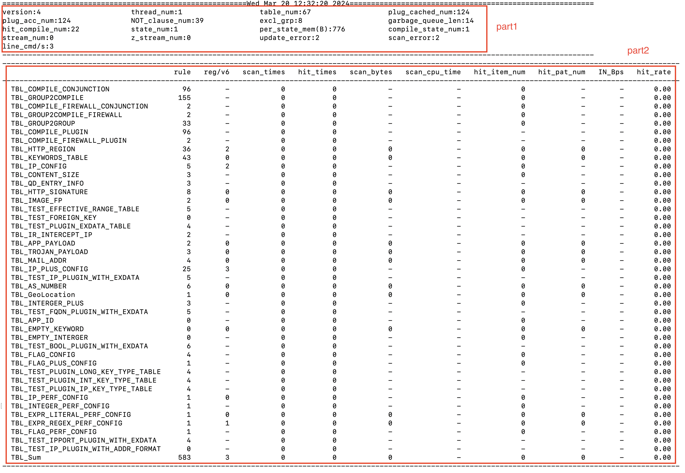

# Monitor tools

## 1. maat_stat

Maat outputs statistical information in running state using fieldstat. To make it easier to view the output in a more readable format, the fieldstat_exporter.py script is provided. This script can be used to convert the JSON format output (stat.log) into a more user-friendly format.

```bash
python3 /opt/MESA/bin/fieldstat_exporter.py local -j ./stat.log -e -t '{{print_tables("TBL",["rule","reg/v6","scan_times","hit_times","scan_bytes","scan_cpu_time","hit_item_num","hit_pat_num","#Name<IN_Bps>#Ratio<scan_bytes,scan_cpu_time,100>","#Name<hit_rate>#Ratio<hit_times,scan_times,1>"],False)}}'
```


The statistical information in the above figure is divided into two parts, part1 provides overall statistics, and part2 provides statistics for each table.

**part1**
- version: current configuration version

- thread_num: number of scan threads

- table_num: number of tables loaded by maat

- plug_cached_num: number of cached configurations for plugin tables with unregistered callback functions

- plug_acc_num: total number of configurations for plugin tables

- NOT_condition_num: total number of negate-conditions

- excl_grp_num: total number of exclude objects

- garbage_queue_len: number of elements in the garbage queue

- hit_rule_num: total number of hits on rule

- state_num: total number of current maat_state

- per_state_num: number of bytes occupied by each maat_state on average

- rule_state_num: total number of current rule_state created within maat_state during partial hits or hits

- stream_num: total number of scanned streams

- z_stream_num: number of zombie streams

- update_error: number of configuration update errors

- scan_error: number of scan errors

**part2**

`Note`: The statistics are output in 2-second cycles, so some statistical indicators represent values for a 2-second period. The previous 2-second statistical values are cleared after output, and the next 2-second statistics are calculated.

- rule: number of rules in this table

- reg/v6: Only valid for expr/expr_plus/ip_plus tables. For expr tables, it represents the number of regular expression; for ip_plus tables, it represents the number of IPv6 rules

- scan_times: Number of times this table is scanned within 2 seconds

- hit_times: Number of times this table is scanned and hit within 2 seconds

- scan_bytes: Total number of bytes scanned in this table within 2 seconds

- scan_cpu_time: CPU time spent on scanning this table within 2 seconds

- hit_item_num: Number of items hit in this table within 2 seconds

- hit_pat_num: Only valid for expr/expr_plus tables, number of patterns hit in this table within 2 seconds (each rule in an expr/expr_plus table, if it is an AND expression, each item in the AND expression is a pattern)

- IN_Bps: Scanning bandwidth

- hit_rate: hit_times/scan_times, indicating the hit rate of the scan

## 2. maat_redis_tool

* Dump the configuration in redis to a local iris format file.

* Quickly check if there are any issues in the process of pulling full configuration from redis.

* Write the configuration in json format to redis. (Not Recommended)

For specific usage, run ./maat_redis_tool -h

## 3. parse the json configuration that has been gzip compressed

compress json configuration using gzip command
```shell
$ gzip -9 < maat_json.json > maat_json.json.gz
```

```c
maat_options_set_json_file_gzip_flag()
```
 This api can indicate whether maat instance needs to decompress the json configuration before loading it. It can be used in conjunction with the encryption command below, compressed first and then encrypted.

## 4. parse the json configuration encrypted by openssl

Using openssl enc to encrypt configuration：

```shell
$ openssl enc -e -aes-128-cbc -k 123456 -p  -nosalt -in inputfile.txt -out encryptfile.txt  
```

decrypt：

```shell
$ openssl enc -d -aes-128-cbc -k 123456 -p -nosalt -in encryptfile.txt -out tmp.txt 
```

```c
maat_options_set_json_file_decrypt_key()
```
This api can specify the decryption key for the JSON file to be decrypted.