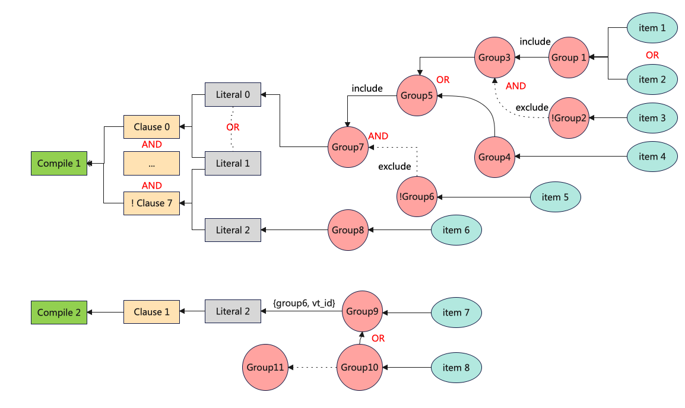
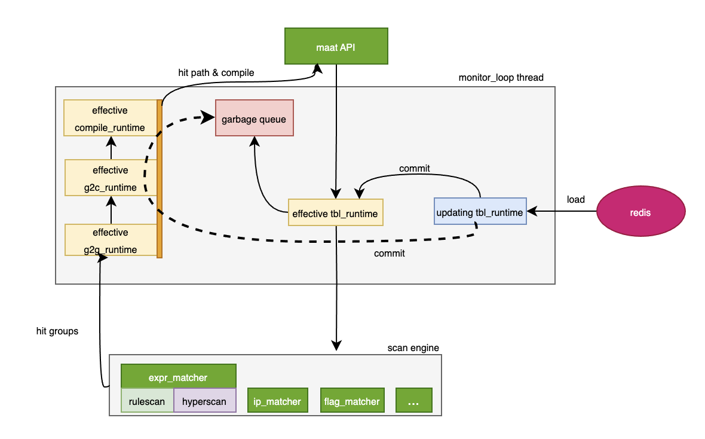

# Overview

## 1. Introduction

Before proceeding, please make sure you are familiar with the [terminology](./terminology.md) related to maat. In the context of maat, configuration can be equivalently understood as rule.

As mentioned in the readme, maat has two typical usage patterns:

**Pattern 1**
* Update rules in the item table, object2rule table, and rule table
* Call the maat scanning api to determine if the actual traffic hits the effective rules
* If a rule is hit, maat can provide detailed information about the hit rule

**Pattern 2**
* Register callback functions for xx_plugin table
* Update rules in the xx_plugin table
* Call xx_plugin_get_ex_data to query the ex_data for a specific key

### 1.1 Configuration

Different types of configurations are stored in different tables. For all configuration types, please refer to the [table schema](./maat_table.md#1-table-schema).

The physical tables are mainly divided into three categories: the item table, object rule relationship table (rule table, object2rule table, object_group table), and xx_plugin table. The first two types of tables are used for maat traffic scanning, while the xx_plugin table is used as a callback table, which can obtain the detailed configuration information for a specific key.

### 1.2 Configuration relationship

As shown in the diagram below, maat organizes and abstracts configurations using terms such as item, object, literal, condition, rule, etc., allowing users to flexibly configure various policies. The term "literal" is an internal concept in maat and is not visible to external users.

In addition, objects support nesting. For more detailed information, please refer to [object hierarchy](./object_hierarchy.md).

If we define literal_id = {field_id, object_id}, then a literal is composed of one or more literal_ids. The multiple literal_ids that form the same condition have a logical “OR” relationship. The multiple conditions that form the same rule have a logical “AND” relationship, and there can be a maximum of 8 conditions within the same rule. In addition, the condition itself supports logical "NOT".

 

### 1.3 Dynamic configuration management

Maat supports three configuration loading modes.

* **Redis mode**(for production): The data source is typically a relational database, such as Oracle, MySQL.
* **Json file mode**(for production and debugging): it's mainly used in unit test
* **Iris file mode**(for troubleshooting)

Redis mode and Json file mode support dynamic loading of configurations, where configurations for different tables are loaded into memory to generate corresponding table runtimes. If you are already familiar with the [thread model](./thread_model.md) of maat, you’ll know that when a maat instance is created, a monitor_loop thread runs in the background. This thread periodically checks for configuration changes and generates new runtimes. Additionally, since the scanning interface also requires access to the runtime, maat uses the RCU(Read-Copy-Update) mechanism to ensure high performance of the scanning. For more details, please refer to [table runtime](./maat_table.md#2-table-runtime).

## 2. High level architecture

 

As indicated by the maat [thread model](./thread_model.md), upon creating a maat instance, a `monitor_loop` thread will be created in the background for dynamic configuration updates. Threads calling maat's scanning interface are created by the caller.

The diagram illustrates the overall architecture of maat, including the control plane for configuration updates and the data plane for external calls.

* **Control Plane**

   As mentioned earlier, maat supports three configuration loading mode, using redis as an example here. The maat `monitor_loop` thread periodically checks for updates in the redis. Updating the configuration of a specific table generates the corresponding updating runtime. When updating is complete, a commit operation is triggered, transforming the updating runtime into a new effective runtime, while the original effective runtime is put into the garbage collection queue.

* **Data Plane**

   When calling the maat scanning interface, it subsequently calls the table runtime of the corresponding table, then proceeds to the scanning engine. Upon the scanning engine returning a hit object, it further searches for the matching `rule_id` through object_group runtime, object2rule runtime, and rule runtime, which is then returned to the caller. In addition, if the caller is interested in the hit path, they can also retrieve it through the interfaces provided by maat.

   The scanning mentioned above all uses the `effective runtime`. If there are configuration changes, it will trigger the construction of `updating runtime`. Once this construction is completed, it will become effective runtime, and the original effective runtime will be put into the garbage collection queue waiting to be recycled.

## 3. Features

* RCU (Read-Copy-Update): From the maat thread model, it is evident that maat follows a typical single-writer-multiple-readers model, making it well-suited for utilizing RCU to avoid potential lock mechanisms. This allows the maat scanning interface to offer higher performance.

* Garbage collection: To ensure high performance of the scanning interface, maat puts old runtime into a garbage collection queue to periodically reclaim memory resources.

* Per-thread scanning: The maat scanning interface operates on a per-thread basis, requiring the thread_id as input parameter when used in a multi-threaded environment. Each thread's scanning is independent and does not interfere with others, ensuring complete isolation.

* Two expression scanning engines (hyperscan & rulescan): `hyperscan` outperforms `rulescan` in terms of scanning performance, especially in regular expression matching. However, the build time becomes unacceptable when the number of configurations exceeds 50k.

   **_Note_**: _Hyperscan engine is always used for regular expressions._

   Maat supports two engine switching modes: auto mode(default) and user-specified mode.

   **Auto Mode**

   When the number of literal string configurations is less than 50k, hyperscan is used; otherwise, rulescan is used.

   **User-specified Mode**

   * Method1: By calling the `maat_options_set_expr_engine` interface, you can specify the engine used for all expr tables at once.

   * Method2: By configuring the `expr_engine` field in the table schema, you can specify the engine used for the table.
   
   *_Note_*: _Method2 takes precedence over Method1_.

* Streaming-based Scanning: For more information on stream-based scanning, please refer [hyperscan](https://intel.github.io/hyperscan/dev-reference/runtime.html#runtime)

## 4. Tools

Maat provides a [command-line tool](./monitor_tools.md#2-maat_redis_tool) that can pull remote redis configurations to local files in iris format, allowing for full-text search or viewing of configurations, which is extremely useful for troubleshooting. Imagine without this tool, you would need to log in to redis and could only view the contents of specified keys. Even worse, there might be someone else making changes to the redis configuration, leading to unpredictable outcomes.

## 5. Test

There are a bunch of [unit tests](../test/) that test specific features of maat.

* maat_framework_gtest: The functional test set is used to ensure the correctness of the maat function. If there are any changes to the maat code, please ensure that these existing cases can run smoothly.

maat_framework_perf_gtest: The performance test set is mainly used to test the time consumption and bandwidth of the maat scanning interface.

* benchmark: Maat performance benchmark test, testing the scanning time of different scanning interfaces under different scale rule sets.

* object_nesting: Functionality and performance test set for object nesting.

* ipport_plugin: Functionality and performance test set for the ipport_plugin table.

## 6. Performance

All of the benchmarks are run on the same TSG-X device. Here are the details of the test setup:

**CPU**: Intel(R) Xeon(R) Gold 5318Y CPU @ 2.10GHz

**RAM**: 128G

```bash
scan consume: The time consumption of a single scan, calculated as the average of 1,000,000 scans for each of the 5 threads.

In scenarios with different numbers of rules, each rule hits only one item → one rule.

Configuration capacity:

IP:       8,000,000
URL:      2,000,000 
Interval: 10,000
FQDN:     2,000,000
Regex:    20,000

```

### 1. literal string scanning
Rule generation method: Random strings up to 64 bytes in length.

|rule_num|build consume(ms)|scan consume(us)|scan_count/PerSec|
|--------|-----------------|----------------|-----------------|
|1k      |27               |1.0             |1,010,305        |
|5k      |115              |1.1             |865,950          |
|10k     |217              |1.2             |813,272          |
|50k     |1,325            |1.8             |536,883          |
|100k    |2,998            |1.7             |601,539          |
|500k    |17,971           |1.7             |560,663          |
|1M      |38,246           |3.3             |300,607          |
|2M      |81,093           |3.4             |293,186          |

### 2. literal stream scanning
|rule_num|build consume(ms)|scan consume(us)|scan_count/PerSec|
|--------|-----------------|----------------|-----------------|
|1k      |24               |0.9             |1,078,981        |
|5k	   |107              |1.0             |975,039          |
|10k     |214              |1.0	           |948,946          |
|50k     |1,286            |1.3             |739,973          |
|100k    |2,858            |1.6	           |617,436          |
|500k    |17,695           |2.3             |426,693          |
|1M      |38,227           |4.3             |229,484          |
|2M      |79,294           |4.4             |222,074          |

### 3. ip scanning
|rule_num|build consume(ms)|scan consume(us)|scan_count/PerSec|
|--------|-----------------|----------------|-----------------|
|1k      |10               |0.5             |1,745,810        |
|5k      |20               |0.5             |1,727,712        |
|10k     |31               |0.6             |1,669,449        |
|50k     |132              |0.6             |1,675,603        |
|100k    |250              |0.6             |1,682,368        |
|500k    |1,382            |0.6             |1,658,925        |
|1M      |3,032            |0.6             |1,696,640        |
|5M      |19,823           |0.6             |1,715,265        |
|10M     |41,757           |0.6             |1,634,521        |

### 4. interval scanning
|rule_num|build consume(ms)|scan consume(us)|scan_count/PerSec|
|--------|-----------------|----------------|-----------------|
|1k      |0.1              |0.7             |1,437,607        |
|5k      |0.5	            |0.7             |1,406,865        |
|10k     |0.9              |0.7             |1,285,677        |

### 5. flag scanning
|rule_num|build consume(ms)|scan consume(us)|scan_count/PerSec|
|--------|-----------------|----------------|-----------------|
|1k      |0.002            |4.0             |247,561          |
|5k      |0.019            |15              |63,476           |
|10k     |0.1              |30              |32,900           |

### 6. ipport_plugin
|rule_num|build consume(ms)|scan consume(us)|scan_count/PerSec|
|--------|-----------------|----------------|-----------------|
|50k     |100              |0.21            |4,629,629        |