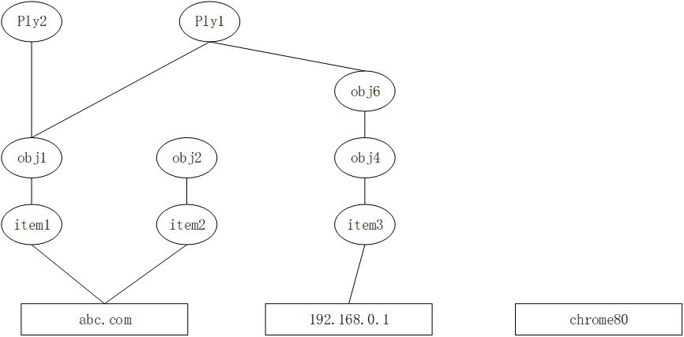

# Scan API

## 最大返回结果限制

多命中情况下，按包含分组数由多到少返回，分组数相同时，按编译配置ID由大到小的顺序返回。

多命中扫描的最大命中次数，受MAX_SCANNER_HIT_NUM宏控制，当前为4096条。

如果命中条数超出4096，则按照配置在IRIS库表文件出现的顺序返回。

## 流式跨包扫描

在配置表描述文件中，如果指定某个字符串类域表设置的跨包缓存值且该值大于0，则在为该表开启流式跨包扫描功能。

进行流式扫描中，会对输入数据结束后缓存该值大小内容，以便下次扫描时进行拼接。会增加一次内存拷贝，并且该拷贝内存在下次扫描时复用。由此决定了下文中Maat_hit_detail_t结构体中命中位置指针的生存周期。

为了避免流式跨包扫描对带偏移量的字符串匹配的功能的干扰，流式扫描结构体中包含了一个当前已扫描长度的变量，用以显示表识输入数据的绝对偏移量。

## 结果缓存复用

另外为了提高系统的性能，为每个scanner分配了一个region_rslt_buff，用以缓存域扫描命中的中间结果。通过malloc分配，长度为sizeof(scan_result_t)*MAX_SCANNER_HIT_NUM*scan_thread_num，当外部调用扫描时，根据thread_num参数，分配region_rslt_buff+MAX_SCANNER_HIT_NUM*thread_num供当前线程保存域中间扫描结果。

### 命中结果返回条件

Maat_xx_scan函数输入的数据命中了某个域配置，且满足某一编译配置就会返回该编译配置ID，无论该编译配置是否已在之前扫描中命中。

### 命中结果执行顺序

多命中情况下，编译配置的按照如下顺序返回：

1. 两条编译配置的执行序号（exec_seq）都不为0，执行序号较小的在前；

2. 执行序号相同，或者有任意一条编译配置的执行序号为0时，依次按照以下顺序返回：
   1. 分组数量较多的在前
   2. 编译配置ID较大的在前

## 命中路径

从待扫描数据的角度，描述其域ID->子分组ID->顶级分组ID（含虚拟表名）->编译配置的ID序列，称为命中路径。

一个待扫描数据在以下情况下有多个命中路径：

- 多规则命中：输入同时命中多个region ID。如
  - 输入URL: abc.com/index.html；规则r1=”abc”，r2=”index.html”；输入有两个分别以r1和r2为起点的命中路径。
- 分组复用
  - 分组间“与”运算

策略的结构是从compile到item的自顶向下，而命中路径是从最底层的item到顶层的compile，是自底向上的。它将网状和层次结构的object-policy图，进行扁平化，转换为图论中的路径。例如，有如下策略：

- 字符串object1，包含 item1="abc" 
- 字符串object2，包含item2=".com"
- 字符串object3，包含object2
- IP object4，包含item3=192.168.0.1/24
- IP object5，包含object4
- IP object6，包含object5
- rule1=object1 & object6
- rule2=object1

输入：url=abc.com，ua=chrome80，IP=192.168.0.1的命中路径为

| 输入        | Region ID | Sub Group ID            | Top Group ID | Virutal Table | Rule ID |
| ----------- | --------- | ----------------------- | ------------ | ------------- | ------- |
| abc.com     | item1     | object1                 | object1      | HTTP_URL      | Rule1   |
| item2       | object2   | N/A（因为没有最终命中） | N/A          | N/A           |         |
| item1       | object1   | object1                 | HTTP_URL     | Rule2         |         |
| 192.168.0.1 | item3     | object4                 | object6      | IP            | Rule2   |
| chrome80    | N/A       | N/A                     | N/A          | N/A           | N/A     |

命中关系还是一张图，采用邻接矩阵存储，而命中路径是邻接矩阵中的一行。

## 组合扫描

同一网络传输单元的多个属性的扫描，是通过scan_status* mid实现的，其中缓存了已命中的子句id，该ID在增量更新中不重用。

在一个mid的生存期内，配置组合关系变化产生新的bool matcher。

- 如果是增量更新，缓存的子句id会和新的bool matcher进行运算。由于子句ID在增量更新中不变化，不会产生误命中。
- 如果是全量更新，缓存的子句id不会和新的bool matcher进行运算。

##  常见故障处理

### 初始化失败

当出现Maat初始化失败、扫描不命中时，首先查看Maat生成的日志文件，FATAL级别的日志都会导致Maat不能正确加载、扫描配置。

日志提示“config file xxx,not full or inc config”，请确认Maat_ feather/Maat_summon_feather/Maat_summon_feather_json初始化时传入的两个路径是否正确，注意路径为IRIS配置线写入的index路径，例如/home/ config/dest/index/，而不是/home /config/dest/。

该日志文件由Maat_summon_feather函数调用时，传递的日志句柄所生成，需要注意的是该句柄的日志级别过高会导致”INFO”级日志不可见。

### 扫描出现段错误

确认扫描传入的maat_state* state已在调用前创建。

确认输入的待扫描内容的内存可访问，长度参数正确。

### 扫描不命中

扫描不命中，首先查看初始化日志，判断加载的配置是否是你期待的路径。

然后，判断配置加载是否有FATAL级别的错误日志。

接下来确认扫描时传入的table_id，与期待的表名是否正确对应，避免出现用表A的配置扫描表B的字段。

对于字符串扫描，charset参数传递正确，且包含在配置表描述文件（通常为table_info.conf）的”目的编码”中。如果不能确定，可以暂时修改配置表描述文件中的do_merge列为”yes”。

在使用带有命中细节的函数扫描时，一般detail_num应与rule_num相等。

IRIS文件模式下，如待命中配置在增量索引中，需要等待延迟加载（日志中Postpone xx entries）完成。调试时，可将MAAT_OPT_SCANDIR_INTERVAL_MS 和MAAT_OPT_EFFECT_INVERVAL_MS设置为20毫秒。

另外，JSON调试只能支持分组的模式下工作，需要在配置表描述文件table_info.conf中增加分组表，否则可能导致误命中或不命中。

 