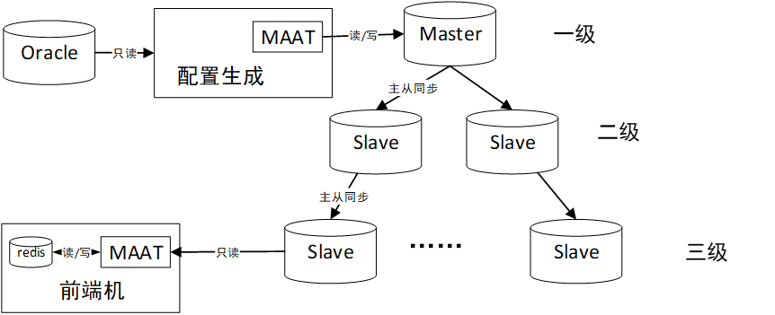
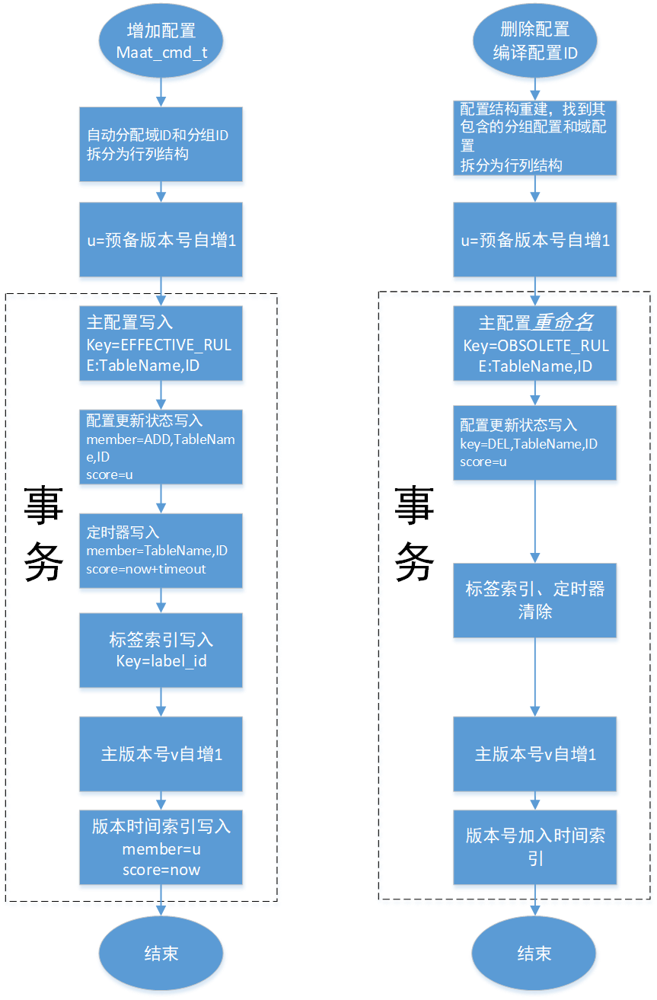
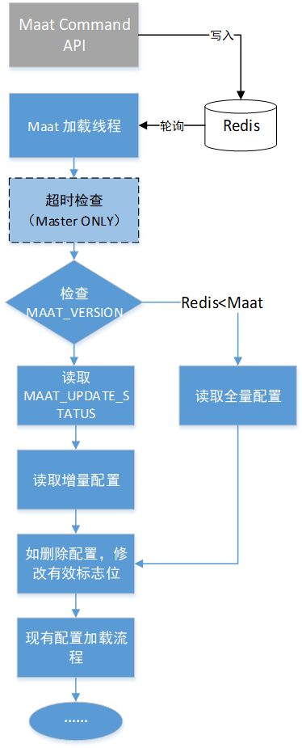

# Table Data

Input must use UTF-8 without BOM encoding, for example, MySQL use utf8mb4.

Maat supports three rule loading modes.
- [Redis mode](#1-redis-mode)
- [Iris mode](#2-iris-mode)
- [Json mode](#3-json-mode)

## 1.<a name='Redis mode'></a> Redis mode

Maat可以通过Redis的主从同步机制，实现配置的分发。本节介绍MAAT加载Redis中配置时，对存储结构的要求。和数据库一样，Redis存储结构的设计上不需要考虑编译、分组和域的逻辑层次。由配置更新线程，通过行列式配置重构各层次间的组合关系。


### 1.1 Transactional Write
表 26 MAAT Redis中定义的数据结构

| Redis KEY               | 名称             | 结构       | 用途                                                         |
| ------------------------------------------------------ | ---------------- | -------------- | ------------------------- |
| MAAT_VERSION            | primary version  | INTERGER  | 标识Redis中配置的版本号。当redis中版本号大于MAAT中配置版本号时，会去读取MAAT_UPDATE_STATUS。 |
| MAAT_PRE_VERSION        | 预备版本         | INTERGER   |        |
| MAAT_TRANSACTION_xx     | 事务配置状态     | LIST        | 用于临时存储事务中的配置状态，xx为MAAT_PRE_VERSION其中的状态在事务结束后会被更新到MAAT_UPDATE_STATUS，本身被删除。 |
| MAAT_UPDATE_STATUS      | 配置状态         | sorted set, member是配置规则，score 为版本号，详见11.3      | MAAT会用ZRANGEBYSCORE命令读取。                              |
| MAAT_RULE_TIMER         | 主配置超时信息   | sorted set, member是配置规则，score为超时间，详见11.4       | MAAT配置更新线程会定时检查超时状况，并设置超时状态。         |
| MAAT_VERSION_TIMER      | 版本创建时间     | sorted Set  | 存储了每个版本的创建时间，score为版本创建时间，member 为version，用以将MAAT_UPDATE_STATUS维持在一个较小的规模。 |
| MAAT_LABEL_INDEX        | 标签索引         | sorted set, element 是配置表名，编译配置ID，score为label_id |      |
| EFFECTIVE_RULE:TableName,ID  OBSOLETE_RULE:TableName,ID | 主配置 |string     | 生效中的配置，结构与10.3中的行结构相同，MAAT会逐条加载。  |
| SEQUENCE_ REGION       | 域ID生成序列号   | INTERGER  | 用于生产者生成不重复的region_id                              |
| SEQUENCE_ GROUP        | 分组ID生成序列号 | INTERGER  | 用于生产者生成不重复的group_id                               |
| EXPIRE_OP_LOCK         | 分布式锁        | 字符串”locked"   | 用于保证最多只有一个写者进行淘汰。                       |


Maat command API 可直接将配置写入 redis
```c
struct maat_cmd_line {
	const char *table_name;
	const char *table_line;
	long long rule_id;		// for MAAT_OP_DEL, only rule_id and table_name are necessary.
	int expire_after;	   //expired after $timeout$ seconds, set to 0 for never timeout.
};

int maat_cmd_set_line(struct maat *maat_inst, const struct maat_cmd_line *line_rule);

Example:
    char table_line[1024] = {0};
    long long item_id = 100;
    long long group_id = 200;
    const char *keywords = "Hello&Maat";
    int expr_type = 1; //EXPR_TYPE_AND
    int match_method = 0; //MATCH_METHOD_SUB
    int is_hexbin = 0;
    int op = 1; //add

    sprintf(table_line, "%lld\t%lld\t%s\t%d\t%d\t%d\t%d", item_id, group_id,
            keywords, expr_type, match_method, is_hexbin, op);

    struct maat_cmd_line line_rule;
    line_rule.rule_id = item_id;
    line_rule.table_line = table_line;
    line_rule.table_name = table_name;
    line_rule.expire_after = expire_after;

    int ret = maat_cmd_set_line(maat_inst, &line_rule);
```

### 1.2 主版本号、预备版本号与Lua Script

生产者写入配置时，先对预备版本号加1，并作为写入配置状态的score，待写入完成后，再对主版本号加1。放弃WATCH MAAT_VERSION的事务。这一方法可以大幅提高写入性能，除ID冲突外，可确保写入成功。

当有多个生产者时，可能存在配置状态与主版本号不一致的问题。主版本号为v，某次更新时在配置状态中声明的版本号为u，消费者增量更新时有以下情况：

- 若v=u，则版本号一致，配置正常加载；
- 若v>u，该情况不存在。因为只有配置状态修改完成，主版本号才会增加1。换句话说，每次写入都是先增加预备版本号，后增加主版本号，所以主版本号必然小于或等于配置状态中的最大版本号。
  - 错误：三个生产者情况下，有问题，如下表。
- 若v<u，说明两个生产者中，先启动写入的并没有先完成。此时，本次只更新到版本v，留待下次轮询再更新至u。

消费者全量更新时不看配置状态，直接读取全部有效配置，因为配置写入和主版本号增加1在同一个事务中执行，读取到的全量配置版本必定与主版本一致。

有多个生产者的情况下，可能丢失配置更新消息状态：

| **Time** | **Producer1**            | **Producer2**            | **Producer3**            | **consmuer**                                    |
| -------- | ------------------------ | ------------------------ | ------------------------ | ----------------------------------------------- |
| **0**    | 准备更新mv=3924, tv=3925 |                          |                          |                                                 |
| **1**    |                          | 准备更新mv=3924, tv=3926 |                          |                                                 |
| **2**    |                          |                          | 准备更新mv=3924, tv=3927 |                                                 |
| **3**    |                          |                          | 更新完毕mv=3925, tv=3927 | Get version 3925, zrangebyscore拿不到3925的状态 |
| **4**    |                          | 更新完毕mv=3926, tv=3926 |                          | Maat版本号升到3926，报错:noncontigous           |
| **5**    | 更新完毕mv=3927, tv=3925 |                          |                          | 3925被跳过                                      |


在事务结束部分，采用lua script检查事务版本号transaction_version与主版本号maat_version：

- tv==mv，无需修正
- tv>mv，本次更新的增量将在下一次
- tv<mv，如何识别本次事务写入配置状态的规则呢？然后才能将其score改为mv

为了解决事物结束时，transaction version<maat_version的问题，使用redis list MAAT_TRANSACTION_xx存储配置更新状态，xx取自MAAT_PRE_VERSION，事务结束时再用lua script同步MAAT_UPDATE_STATUS，并删除MAAT_TRANSACTION_xx。



#### 1.3 MAAT_UPDATE_STATUS

该结构中使用Sorted Set存储了主配置的变化状态，score为版本号，member为配置状态。member的0～2字节描述了更新指令：

1. ADD，即配置增加，结构为ADD,TableName,ID；
2. DEL，即配置删除，结构为DEL,TableName,ID；

MAAT在发现MAAT_VERSION变化后，会用ZRANGEBYSCORE读取更新的配置状态（按VERSION升序），并检测第一个配置的Score，如该Score>Maat版本+1，则说明有遗漏的更新（网络长时间中断），启用全量更新流程。

对于DEL状态，如果查询不到对应的主配置状态，同样说明有遗漏更新（网络中断时间超过OBSOLETE_RULE超时时间），启用全量更新流程。

#### MAAT_EXPIRE_TIMER

该结构使用Sorted Set存储了主配置的超时信息，score为绝对超时时间，member的结构为TableName,ID。


#### MAAT_VERSION_TIMER

该结构使用Sorted Set存储了每个版本的创建时间，score为版本创建时间，member为 版本号（version），即MAAT_UPDATE_STATUS的score，用以将MAAT_UPDATE_STATUS维持在一个较小的规模。

#### 主配置结构

有两类配置命名方式：

1. EFFECTIVE_RULE:TableName,ID 表示正在生效的配置；
2. OBSOLETE_RULE:TableName,ID 表示已经删除的配置，这些配置超时（EXPIRE）后会被Redis删除。

### Load From Redis
Maat实例的工作线程定时轮询Redis中MAAT_VERSION，如果大于实例的MAAT_VERSION则进行更新。



### 读写性能

为保证事务，Redis需工作在单机+主从模式。带超时的配置写入5000条/秒，无超时配置10000条/秒。


## 2.<a name='Iris mode'></a> Iris mode

在Maat可以监听全量和增量目录下的文件来更新配置运行时变化，下面对这种模式下的文件格式进行介绍。

配置是由一个索引文件和若干配置数据文件组成的。索引文件通过索引文件命名标识不同版本。

### 索引文件命名

全量索引文件名的格式为full_config_index.SEQ（如full_config_index. 00000000000000055410），增量索引文件名的格式为inc_config_index.SEQ，分别存放在全量索引约定目录和增量索引约定目录下。

其中SEQ为配置线维护的自增序列,该序列保证：

1） 当两个索引约定目录不为空时，新生成的索引文件比后生成的索引文件序号大；（建议使用数据库内的配置版本号或通过写入本地磁盘以保证一致性）

2） 同一次下发产生全量索引文件与增量索引文件的的序列号相同；

3） 序列号的格式为20位数字，不满20位时用0补位，取值范围不超过C语言中有符号长整型（long long）的上下界，即0~2^63-1。

### 索引文件格式

如下表所示。列间以\t分割，行间以\n分割。配置数据文件路径为绝对路径。

表 24索引文件格式/示例表

| **列名** | **table name** | **Config num** | **Table file path**                            | 加密算法(可为空) |
| -------- | -------------- | -------------- | ---------------------------------------------- | ---------------- |
| **示例** | PASS_WHITE_IP  | 3              | /home/config/full/2014-04-24/PASS_WHITE_IP.123 |                  |
|          | PASS_URL       | 2              | /home/config/full/2014-04-24/PASS_URL.123      | aes-128-cbc      |

### 配置数据文件格式

如下所示。列间用\t分割，行之间用\n分割。首行为当前数据文件中包含的配置总数，此值应以索引文件中对应的config_num一致。

表 25配置数据文件格式示例

```
3
45695	2	202.108.181.33	255.255.255.255	0	1
48697	2	202.108.181.33	255.255.255.255	0	1
66699	2	202.108.181.33	255.255.255.255	0	1
```

### 手工修改IRIS配置

通常**不建议**直接手工修改IRIS配置，调试应使用JSON模式。

增加库表需要修改以下文件：

1. 在库表文件索引中增加新的库表路径及条目数
2. 在库表描述文件（table_info.conf）中增加库表的信息
3. 修改配置汇总表，使新增加配置生效，注意要保证第一行配置总数与实际的配置行数一致

手工增加已有库表配置需要修改以下文件

1. 在需要修改的库表文件中追加行，region_id不能与已有所有域表中的冲突，并修改文件第一行的行数
2. 在配置汇总表中增加该配置的汇总信息，注意要和库表文件中的compile_id一致，且不能与已有compile_id冲突，修改文件第一行的行数
3. 在库表索引文件中修改配置汇总表和域表的行数

## 3.<a name='Json mode'></a> Json mode

使用Maat_summon_feather_jsonMaat_set_feather_opt函数通过选项MAAT_OPT_JSON_FILE_PATH设置，进行JSON格式配置的加载。Maat在初始化后，一旦检测到文件MD5值的变化，则以全量更新的方式加载变化的json文件。

采用JSON文件进行描述，纯文本可以使用JSON Viewer进行编辑和格式检查。

```json
{   //JSON语法不支持注释，直接将以下内容拷贝后，应删除注释后才符合JSON语法
    //规定内容区分大小写，不可混用
    "compile_table": "COMPILE",//编译表表名，优先级高于配置表描述中的compile表
    "group_table": "GROUP",//分组表表名，优先级高于配置表描述中的group表
    "rules": [
        {
            "compile_id": 123, //编译配置ID，数值，注意不要重复
            "service": 1, //32位有符号整数
            "action": 1, //8位有符号整数
            "do_blacklist": 1, //8位有符号整数
            "do_log": 1, //8位有符号整数
            "effective_range": 0, //生效范围，置0，已被配置生效标签取代
            "tags":"{\"tag_sets\":[[{\"tag\":\"location\",\"value\":[\"北京/朝阳/华严北里\",\"上海/浦东/陆家嘴\"]},{\"tag\":\"isp\",\"value\":[\"电信\",\"联通\"]}],[{\"tag\":\"location\",\"value\":[\"北京\"]},{\"tag\":\"isp\",\"value\":[\"联通\"]}]]}", 
                                          //tags为配置生效标签
            "user_region": "anything",//用户自定义域，不超过128字节的字符串，不可//包含空格或制表符
            "is_valid": "yes",//有效标志，有效：”yes”，无效：”no”            
            "evaluation_order": "100.2",//执行顺序，双精度浮点数，为了便于转换，用//字符串形式
            "table_name": "COMPILE_ALIAS", //编译配置表名，可选，
                                        //默认使用compile_table
            "groups": [    //接下来描述配置包含的分组
                {
                    "group_name": "IP_group",//分组名，用于辅助记忆，注意不要重复
                                          //重复分组名表示分组内容复用。
                                          //可以使用”Untitled”作为分组名表示无需                                                                                                                                                                                                                 //复用，此时由Maat自动生成group_id。
//无group_name时，视为”Untitled” 。   
"not_flag":0, //非运算标志位，1表示不能包含该分组，默认为0 
“virtual_table”:”HTTP_RESPONSE_KEYWORDS”, //虚拟表名，可选  
                    "regions": [  //对分组内配置域的描述
                        {
                            "table_name": "IP_CONFIG", //域表表名和类型，应与配置表
//描述文件一致
                            "table_type": "ip",//类型包括 ip, string, interval 三种
                            "table_content": {//以下是ip类配置表的格式
                                "addr_type": "ipv4",//地址类型，可选ipv4和ipv6
                                "src_ip": "10.0.6.201", 
                                "mask_src_ip": "255.255.255.255",
                                "src_port": "0",
                                "mask_src_port": "65535",
                                "dst_ip": "0.0.0.0",
                                "mask_dst_ip": "255.255.255.255",
                                "dst_port": "0",
                                "mask_dst_port": "65535",
                                "protocol": 6,
                                "direction": "double"//扫描方向，single或double
                            }
                        },
                        {
                            "table_name": "IP_CONFIG",
                            "table_type": "ip",
                            "table_content": {
                                "addr_type": "ipv4",
                                "src_ip": "192.168.0.1",
                                "mask_src_ip": "255.255.255.255",
                                "src_port": "0",
                                "mask_src_port": "65535",
                                "dst_ip": "0.0.0.0",
                                "mask_dst_ip": "255.255.255.255",
                                "dst_port": "0",
                                "mask_dst_port": "65535",
                                "protocol": 6,
                                "direction": "double"
                            }
                        }
                    ]
                },
                {
                    "group_name": "Untitled",//用”Untitled”作为分组名表示不需                                                                                                                                                                                                                 //要复用
                    "regions": [
                        {
                            "table_name": "HTTP_URL",
                            "table_type": "string",
                            "table_content": {
                                "keywords": "abc&123",//格式遵循字符串类与配置一
//节的约定，”\”需要写作”\\”
                                "expr_type": "and",//表达式类型，包括none, and,
// regex, offset
                                "match_method": "sub",//匹配模式,包括sub, right,
//left, complete
                                "format": "uncase plain"//格式类型，包括uncase plain,
// hexbin, case plain
                            }
                        }
                    ]
                }
            ]
        },
        {
            "compile_id": 124,
            "service": 1,
            "action": 1,
            "do_blacklist": 1,
            "do_log": 1,
            "effective_range": 0,
            "user_region": "anything",
            "is_valid": "yes",
            "groups": [
                {
                    "group_name": "IP_group"//复用上一条编译配置的分组，仅列名字，
//重复分组名的域配置不会生效
                },
                {
                    "group_name": "Untitled",//Untitled表示该分组不会被复用
                    "regions": [
                        {
                            "table_name": "CONTENT_SIZE",
                            "table_type": "interval",
                            "table_content": {
                                "low_boundary": 100, //上下界的约定参照数值类域配
                                "up_boundary": 500  //置表定义
                            }
                        }
                    ]
                }
            ]
        },
{
    "compile_id": 125,
    "service": 1,
    "action": 1,
    "do_blacklist": 1,
    "do_log": 1,
    "effective_range": 0,
    "user_region": "anything",
    "is_valid": "yes",
    "groups": [
      {
        "group_name": "group_4",
         "regions": [
                        {
                            "table_name": " TARGET_FILE_DIGEST ",
                            "table_type": "digest",
                            "table_content": {
                                " raw_len ": 20436318, //文件的原始长度
                                "digest": "VY2DfSUuQ5xkNQTnCN8iwd0VM5h3WVOunA/Jk87S3kfpukO84AL1qvmq2brnBt9sPvrfeaRip9Y+VhuEk0Sy4dvdKtk8DdSFOa7ZM[0:20436317]",          //通过digest_gen工具生成的摘要 
                                "cfds_level": 3    //摘要匹配置信度
                            }
                        }
          ]
      }
     ]
},
        {
            "compile_id": 128,
            "service": 1,
            "action": 1,
            "do_blacklist": 1,
            "do_log": 1,
            "effective_range": 0,
            "user_region": "anything",
            "is_valid": "yes",
            "groups": [
                {
                    "group_name": "group_8",
                    "regions": [
                        {
                            "table_name": "HTTP_REGION",
                            "table_type": "expr_plus",    //扩展的字符串表
                            "table_content": {
                            	"district": "URL",  //keywords的匹配区域，大小写敏感
                                "keywords": "abckkk&123",
                                "expr_type": "and",
                                "match_method": "sub",
                                "format": "uncase plain"
                            }
                        }
                    ]
                }
            ]
        }
],
   "plugin_table":[               //回调表，可不配置
	 	{
	  		"table_name":"QD_ENTRY_INFO",
	  		"table_content":[
                "1\t192.168.0.1\t101",//回调表行，使用Tab键或’\t’分隔
                "2\t192.168.0.2\t101",
                "3\t192.168.1.1\t102"	  		]
	 	},
	 	{
	  		"table_name":"TEST_PLUGIN_TABLE",
	  		"table_content":[
                "1\t3388\t99\t1",
                "2\t3355\t66\t1",
                "3\tcccc\t11\t1"
	  		]
	 	}
    ]
}

```

## 组合配置写入示例 

已知IP类域配置表IP_TABLE、关键字类配置表KEYWORD、编译配置表COMPILE、分组表GROUP。

GRP为group_id的数据库sequence，REGION为region_id的数据库sequence，COMPLIE为compile_id的数据库sequence

先要求写入规则(IP_TABLE:192.168.0.1|IP_TABLE:192.168.0.2)&(KEYWORD:abc)

写入顺序如下：

1、     从数据库中取 group_id1=GRP.next, region_id1=REGION.next, compile_id1=COMPILE.next;

2、     将"group_id1,compile_id1,1"写入GROUP表;

3、     将"group_id1,region_id1,abc"写入KEYWORD表;

4、     从数据库中取 group_id2=GRP.next

5、     将"group_id2,compile_id1,1"写入GROUP表;

6、     对于IP地址192.168.0.1，从数据库获取region_id2=REGION.next；

7、     将"group_id2,region_id2,192.168.0.1"写入IP_TABLE表；

8、     对于IP地址192.168.0.2，从数据库中取 region_id3=REGION.next

9、     将"group_id2,region_id3,192.168.0.2"写入IP_TABLE表；

10、   将"compile_id1,group_num=2"写入COMPILE表；

此时各个表中的记录如下：

```
COMPILE表：
c1,2;
GROUP表:
g1,c1
g2,c1
KEYWORD表:
g1,r1,abc
IP_TABLE表:
g2,r2,192.168.0.1
g2,r3,192.168.0.2 
```

新增一个关键字"edf"，也要使用IP组g2，则增加三条记录：

COMPILE:

c2;

GROUP:

g3,c2

g2,c2

KEYWORD:

g3,r5,edf

 

则当前库表记录状态为

```
COMPILE表：
c1,2;
c2,2;
GROUP表:
g1,c1
g2,c1
g3,c2
g2,c2
KEYWORD表:
g1,r1,abc
g3,r5,edf
IP_TABLE表:
g2,r3,192.168.0.2
g2,r4,192.168.0.3
```

新增IP

- 如果用户在group_id2分组中增加IP，则从数据库中取 region_id4=REGION.next，将"group_id2,region_id4,192.168.0.3"写入KEYWORD表；即可 

删除IP

- 如果用户要删除group_id2分组中的IP192.168.0.1，则将IP_TABLE表中g2,r2,192.168.0.1 该条记录置为失效

## 配置更新机制

### 最短加载间隔

Maat的配置管理线程会针对增量索引文件目录进行扫描，在初始化后每隔1s（默认），扫描增量配置目录。同时为了避免自动机频繁更新，耗尽内存，自动机最短每隔60s（默认）创建一次，如果两次**增量**配置更新间隔小于60s，则会累积在更新队列中，直到与上次更新自动机间隔60s才会批量加载。全量配置和回调类配置更新不受最短加载时间的限制。

文件扫描间隔和配置生效间隔，可以通过Maat_set_feather_opt设置，详见本文档“函数接口”一章。

### 延迟删除机制

Maat使用延时删除机制，在不使用锁的前提下保证线程安全。

即配置管理线程在更新操作中：

a)    需要删除group_rule、compile_rule时，将他们放入垃圾回收队列，待超时后（默认10）后再进行释放。

b)   需要读取时，直接访问；

c)    需要修改时，获得mutex后访问

扫描线程中：

a)    需要读取时，获得mutex后访问