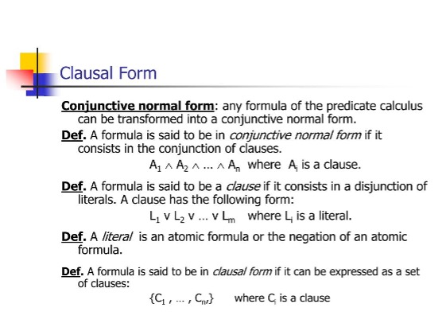
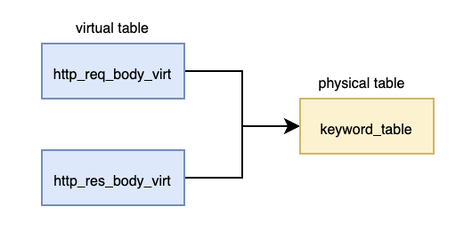

# Terminology 

* [Item](#item)
* [Group(Object)](#groupobject)
* [Rule(Policy)](#rulepolicy)
* [Condition(Condition)](#condition)
* [Literal](#literal)
* [Physical table](#physical-table)
* [Attribute](#attribute)
* [Table schema](#table-schema)
* [Table runtime](#table-runtime)
* [Table rule](#table-ruleconfiguration)
* [Conjunction](#conjunction)
* [Maat state](#conjunction)
* [Maat stream](#maat-stream)
* [Half/Full hit](#halffull-hit)
* [Hit path](#hit-path)
* [Redis](#redis)

## Item

As a filter for network attributes, the smallest unit of a rule

- Eg1: specify that the UserAgent field in the HTTP protocol contains substrings "Chrome" and "11.8.1",  
   &ensp;&ensp; HTTP UserAgent: Chrome & 11.8.1

- Eg2: specify that the domain name in the HTTP protocol ends with ".emodao.com"  
   &ensp;&ensp; HTTP HOST: *.emodao.com

- Eg3: specify client IP address belongs to the C segment of 202.118.101.*  
   &ensp;&ensp; Source IP: 202.11.101.0/24

There are multiple types of items stored in corresponding tables such as string, IP and numerical range, more details can be found in [Item table](./maat_table.md#11-item-table).

## Group(Object)

A group defines a set that can contain different types of items and can also reference other groups. The definition is made using items, which can be used to add to or exclude from the group definition. Groups can also have subordinate groups whose definitions are included in or excluded from the superior group.

- An item only belongs to one group, but one group can has multiple items. The multiple items under the same group are logical 'OR' relationships. e.g.(g1 = item1 | item2).

- A group can be included or excluded by other groups. For example, if group1 and group2 is included by group3, then the group3 is called the superior(super) group, and group1(group2) is called the subordinate(sub) group. There's a logical 'OR' relationship between the included sub groups under the same group, e.g.(g3 = incl-g1 | incl-g2). There's a logical 'AND' relationship between included group and excluded group under the same group, e.g.(g4 = incl-g1 & excl-g2).

- Group supports multi-level nesting, see [group hierarchy](./overview.md#groupobject-nesting-and-hierarchies)

- A Group can be referenced by different rules.

The relationship between group and group is stored in the [group2group table](./maat_table.md#14-group2group-table).

## Rule(Policy)

A conjunctive normal form(CNF) consisting of multiple groups and attributes.

`Note`: A rule can contain up to 8 conditions and multiple conditions in the same rule can be logical 'AND' and logical 'NOT' relationships.

The relationship between group and rule is stored in the [group2rule table](./maat_table.md#13-group2rule-table).

 

## Condition

A condition consists of several Literals and the relationship between them is a `logical 'OR'`.

Conditions are divided into two categories based on whether they contain the logical "NOT" operation: `condition` and `NOT-condition`. In Maat, the logical "NOT" only appears in the condition, which means that if you want to use the logical "NOT", you need to configure conditions for the rules.

## Literal

A Literal consists of `attribute_id(attribute id)` and `group_id`. During the rules loading process, a unique condition_id  will be generated based on the combination of attribute_id and group_id in the same condition.

## Physical table

Different rules are stored in different tables in the actual database, including [item table](./maat_table.md#11-item-table), [rule table](./maat_table.md#12-rule-table), [group2rule table](./maat_table.md#13-group2rule-table), [group2group table](./maat_table.md#14-group2group-table), and [xx_plugin table](./maat_table.md#15-plugin-table), and so on.

## Attribute

A attribute references a physical table. In practice, network traffic attributes are commonly used as attribute, such as HTTP_HOST, SSL_SNI, etc. The constraints of attributes are as follows:

* A attribute can only reference one physical table. If it need to reference multiple physical tables of the same type, these physical tables can be first joined together into one table and then referenced.

* A physical table can be referenced by different attributes. For example, the keyword_table can be referenced by two attributes, http_request_body_virt and http_response_body_virt.

 

## Table schema

Defines the type of table and the configuration format, determining the specific meaning of each column in the table. Maat parses the configuration according to the schema, more details can be found in [table schema](./maat_table.md#1-table-schema).

## Table runtime

The runtime generated by loading the configuration in the table into memory. Different tables have different runtimes. The group2rule table is merged with the corresponding rule table to generate a rule runtime, meaning there is no separate group2rule runtime. 

Different scanning api use runtimes of different tables. For example, the HTTP_URL table is of type expr, and its corresponding scanning interface is maat_scan_string. Therefore, when calling this scanning interface, the API internally uses the runtime of the HTTP_URL table to perform the actual scanning task.

## Table rule(configuration)

Different types of rules are stored in tables of different types, such as IP addresses, numerical ranges, strings, and so on.

## Conjunction

By default, maat builds a separate runtime for each physical table, which can be used for rule matching by specifying the table ID during scanning. If the user wants to combine multiple physical tables of the same type into a single table for runtime build and scan, it means conjunction of multiple tables. 

`Note`: Only physical tables support conjunction.

## Maat state

Maat state is used to record intermediate states of scans. For example, a set of scans includes an IP address scan and an IP geolocation scan. The configured rule can determine whether the scan is matched only after the two scans are complete.

In this case, the intermediate state of the first scan is stored in the maat state until the second scan is completed to provide the final hit result.

## Maat stream

Maat supports not only block-based scanning but also stream-based scanning. For more information on stream-based scanning, please refer [hyperscan](https://intel.github.io/hyperscan/dev-reference/runtime.html#runtime). 

## Half/Full hit

From the diagram of [configuration relationship](./overview.md#12-configuration-relationship), it can be seen that if the group that is hit is not referenced by rule, or even if referenced by rule, but after logical operations no rule is hit, then this hit is called a half hit; if a rule is hit, then this hit is called a full hit.

## Hit path

From the relationship of item, group, and rule mentioned above, if a scan hits a certain rule, there must be a logical path composed of item_id -> group_id -> rule_id. Maat names this path the hit path. If a group has nested references, the hit path should be item_id -> sub_group_id -> group_id -> rule_id.

## Redis

In-memory data store，see https://redis.io/. It has a leader follower replication to ensure the high availability of rules