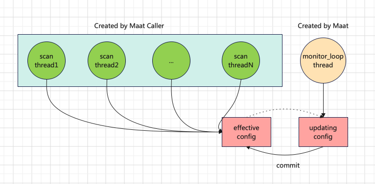

# Thread mode

Maat will create a monitor loop thread internally when calling maat_new to create maat instance. Scaning threads are created extenal maat caller. So all maat_scan_xx APIs are per-thread




Sample
```c

const char *table_info_path = "table_info.conf";
size_t thread_num = 5;

struct thread_param {
	int thread_id;
	struct maat *maat_inst;
	const char *table_name;
};

void *string_scan_thread(void *arg)
{
    struct thread_param *param = (struct thread_param *)arg;
    struct maat *maat_inst = param->maat_inst;
    const char *table_name = param->table_name;
    const char *scan_data = "String TEST should hit";
    long long results[ARRAY_SIZE] = {0};
    size_t n_hit_result = 0;

    struct maat_state *state = maat_state_new(maat_inst, param->thread_id);
    int table_id = maat_get_table_id(maat_inst, table_name);
    
    int ret = maat_scan_string(maat_inst, table_id, scan_data, strlen(scan_data),
                                results, ARRAY_SIZE, &n_hit_result, state);
    EXPECT_EQ(ret, MAAT_SCAN_HIT);
    EXPECT_EQ(n_hit_result, 1);
    EXPECT_EQ(results[0], 123);
        
    maat_state_free(state);

    return NULL;
}

int main()
{
    struct maat_options *opts = maat_options_new();
    maat_options_set_caller_thread_number(opts, thread_num);
    struct maat *maat_inst = maat_new(opts, table_info_path);

    size_t i = 0;
    pthread_t threads[thread_num];
    struct thread_param thread_params[thread_num];

    for (i = 0; i < thread_num; i++) {
        thread_params[i].maat_inst = maat_inst;
        thread_params[i].thread_id = i;
        thread_params[i].table_name = table_name;
        pthread_create(&threads[i], NULL, string_scan_thread, thread_params+i);
    }

    for (i = 0; i < thread_num; i++) {
        pthread_join(threads[i], NULL);
    }
    
    return 0;
}

```