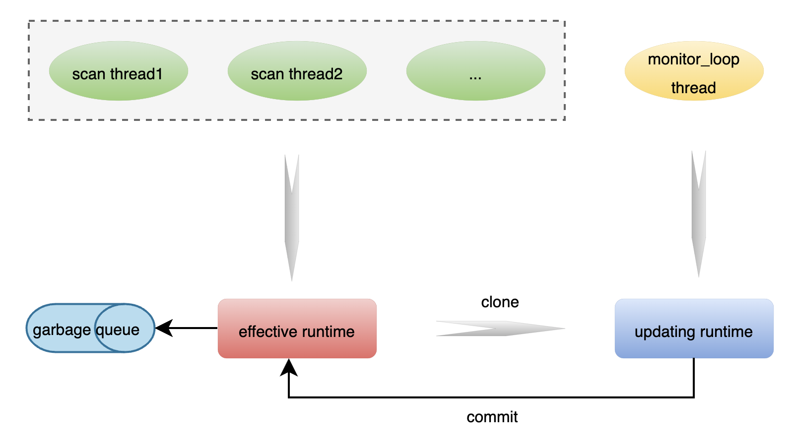

# Thread model

When the maat_new interface is called to create a maat instance, maat will internally create a monitor_loop thread, which will periodically check if there are any configuration updates in Redis or JSON files. If there are updates, it will update the corresponding table's runtime. The thread that executes the actual scanning task is created by the caller, and maat supports multi-threaded scanning. The thread model is illustrated in the diagram below:

 

From the diagram, it can be seen that multiple threads call the scanning interface, which internally references the effective runtime. Since the scanning interface needs to ensure high performance, when a configuration update occurs, the runtime cannot be directly modified to avoid potential multi-threading safety issues. Therefore, the RCU mechanism is employed, where the monitor_loop thread clones an updating runtime and performs update operations on this runtime. When the updating runtime is ready, it is switched to a new effective runtime through a commit action, and subsequent scans will use this runtime.

One issue to consider is if a thread calls the scanning interface and the commit operation occurs immediately, resulting in the updating runtime becoming the new effective runtime. The original effective runtime cannot be destroyed immediately because the thread's scanning task is not yet complete. When can the original effective runtime be destroyed? It is necessary to evaluate the longest time for a single scanning task, as outlined in [performance](./overview.md#6-performance). It is evident that, in a known configuration scenario, the longest time is 30us. Therefore, the delay for destroying the runtime should not be less than 30us. In the current implementation, it is set to 100us to ensure that invalid runtime pointers are not accessed.